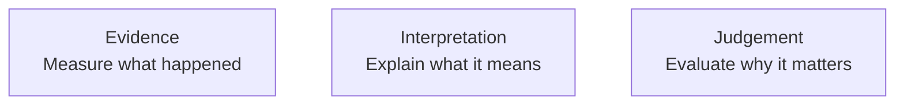


# How to Get a Strong Grade in CA1

Focus on the quality of the engineering investigation — not the quantity of configuration screenshots.

**A strong submission does more than show that the system worked.**

## What the Markers Are Looking For

- Clear decisions and a convincing engineering rationale
- A fair, controlled and repeatable investigation method
- A technically credible implementation
- Relevant evidence that supports the claims being made
- Critical evaluation of what improved - and what did not
- Clear, professional communication across both deliverables

**The highest marks come from evidence and evaluation, not from configuration alone.**

## 1. Justify Your Decisions

- State the problem you are trying to investigate
- Show the architecture clearly enough for the reader to understand the design
- Explain why the main design choices are appropriate
- State important assumptions, constraints and dependencies
- Acknowledge trade-offs rather than presenting one design as perfect
- Keep implementation detail only where it supports your reasoning

**A strong answer explains WHY - not just WHAT.**

## 2. Design a Fair Investigation

- Establish a clear baseline before making changes
- Define the workload and test conditions before running the experiment
- Keep important conditions consistent when comparing results
- Choose metrics that relate directly to the question being investigated
- Record enough detail for the test to be repeated
- Plan failure or stress experiments deliberately - do not improvise them afterwards

**Ask: What changed? What stayed constant? What did I measure? Why?**

## 3. Use Evidence Well

- Select evidence that directly supports a claim or comparison
- Label graphs, screenshots and tables so the reader knows what matters
- Use before/after or baseline/changed comparisons where appropriate
- Quantify the result when possible rather than relying on vague descriptions
- Explain the relationship between the workload, the observed metric and the outcome
- Interpret unexpected results instead of hiding them

**Do not write “the graph shows...” and stop there - explain what the graph means.**

## 4. Evaluate - Do Not Just Describe

- State clearly what the evidence allows you to conclude
- Distinguish improvement from complete success
- Identify remaining limitations, bottlenecks or risks
- Discuss scalability and resilience as separate concerns where relevant
- Consider trade-offs such as cost, complexity, security and sustainability
- Propose a realistic next improvement and justify why it should come next

**The question is not “Did it work?” - it is “What did we learn about the system?”**  

## 5. Make the Report and Screencast Work Together

**Report**  

- Provide the detailed method and evidence
- Explain decisions and assumptions
- Present comparisons clearly
- Develop the full engineering evaluation

**Screencast - max 6 minutes**  

- Frame the problem briefly
- Show only the strongest evidence
- Explain what the evidence means
- Finish with a clear conclusion

**Do not repeat the report word-for-word. Let each format do a different job.**

## Final Checklist Before You Submit

- Is the problem and purpose of the investigation clear?
- Have I justified the important decisions I made?
- Are my experiments fair, controlled and repeatable?
- Does each piece of evidence support a specific claim?
- Have I explained what the results mean, not just what happened?
- Have I identified limitations and trade-offs honestly?
- Do the report and screencast complement each other without unnecessary repetition?

**Design it. Test it. Measure it. Explain it. Evaluate it.**

---
