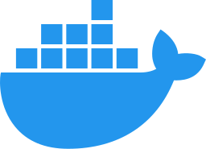
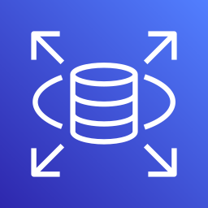
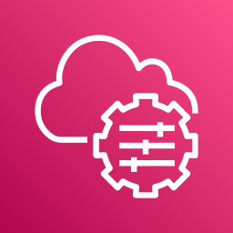
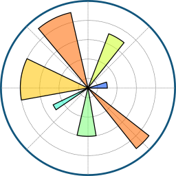
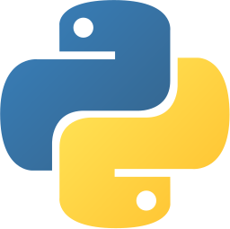
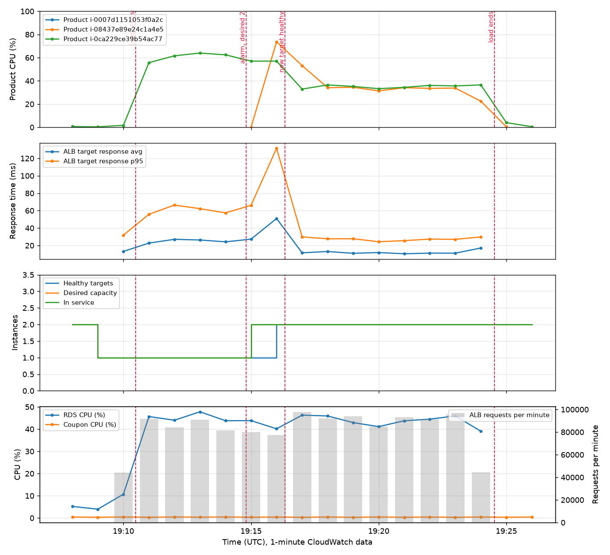
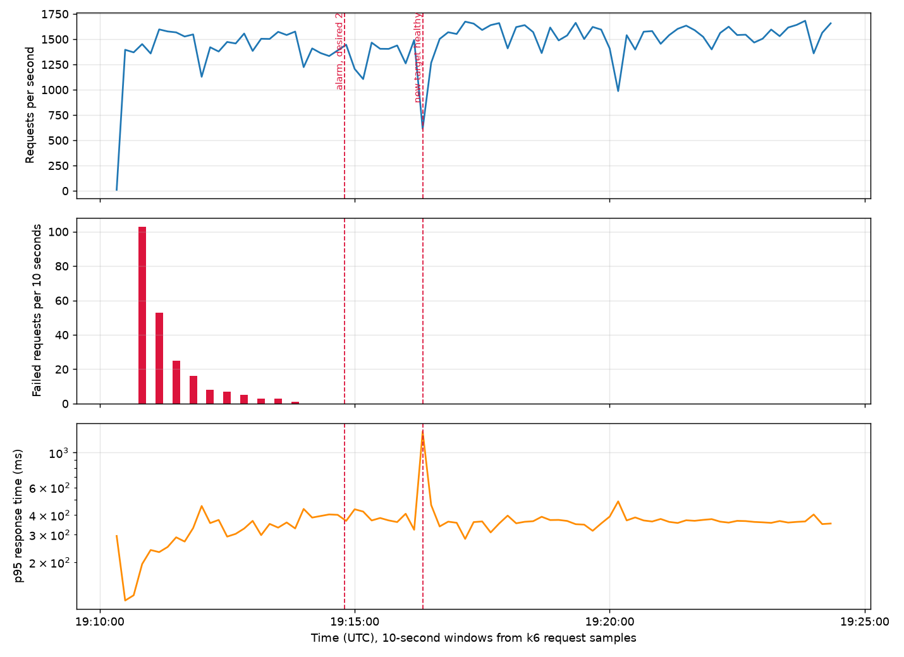
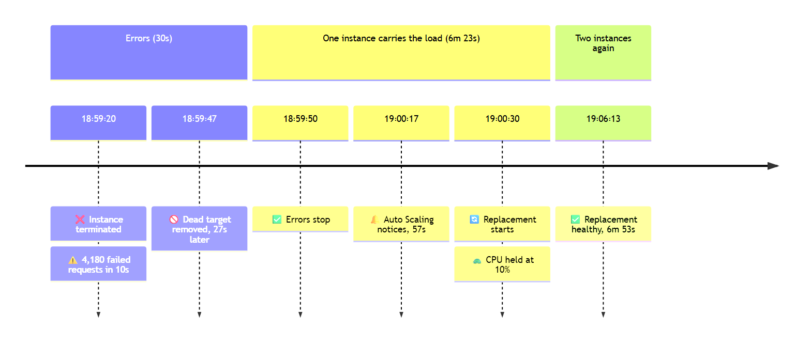

# Cloud Scalability and Resilience on AWS

<!-- title-page:start -->
<div align="center">

**Horizontal scaling of the Product-Coupon application**  

**Mark Crowe**  
MSc in Software Design with Cloud Computing  
Container Design and Deployment – CA1  
November 2026

> "~~Peace~~ ***Failure*** was never an option." – Magneto, *X-Men: First Class* trailer (2011), adapted

</div>
<!-- title-page:end -->

---

<!-- toc:start -->
**Contents**  

- [Overview](#overview)
- [Chapter 1: Problem and architecture](#chapter-1-problem-and-architecture)
  - [1.1 Problem](#11-problem)
  - [1.2 Deployed architecture](#12-deployed-architecture)
    - [The first design (Dragonfly), replaced](#the-first-design-dragonfly-replaced)
  - [1.3 Design decisions and rationale](#13-design-decisions-and-rationale)
    - [D01 – Product is stateless](#d01--product-is-stateless)
    - [D02 – One load balancer as the endpoint](#d02--one-load-balancer-as-the-endpoint)
    - [D03 – Health check on the Actuator](#d03--health-check-on-the-actuator)
    - [D04 – Deregistration delay of 30 seconds](#d04--deregistration-delay-of-30-seconds)
    - [D05 – Launch template and Auto Scaling group across two zones](#d05--launch-template-and-auto-scaling-group-across-two-zones)
    - [D06 – Start-up by user data instead of a custom image](#d06--start-up-by-user-data-instead-of-a-custom-image)
    - [D07 – JARs in a private S3 bucket, read through an IAM role](#d07--jars-in-a-private-s3-bucket-read-through-an-iam-role)
    - [D08 – Database settings in Parameter Store](#d08--database-settings-in-parameter-store)
    - [D09 – Security groups in a chain](#d09--security-groups-in-a-chain)
    - [D10 – Systems Manager instead of SSH or direct access](#d10--systems-manager-instead-of-ssh-or-direct-access)
    - [D11 – Coupon on a single instance](#d11--coupon-on-a-single-instance)
    - [D12 – RDS Multi-AZ, db.t3.micro](#d12--rds-multi-az-dbt3micro)
    - [D13 – t3.micro for Product](#d13--t3micro-for-product)
    - [D14 – Own VPC with three tiers](#d14--own-vpc-with-three-tiers)
    - [D15 – One NAT gateway per zone](#d15--one-nat-gateway-per-zone)
- [Chapter 2: Experimental method](#chapter-2-experimental-method)
  - [2.1 Approach](#21-approach)
  - [2.2 Workloads](#22-workloads)
    - [W01 – List products](#w01--list-products)
    - [W02 – Create products](#w02--create-products)
  - [2.3 Load profile](#23-load-profile)
  - [2.4 Metrics](#24-metrics)
  - [2.5 Hypotheses](#25-hypotheses)
    - [H01 – One instance reaches a limit](#h01--one-instance-reaches-a-limit)
    - [H02 – Two instances serve more](#h02--two-instances-serve-more)
    - [H03 – Writes gain less than reads](#h03--writes-gain-less-than-reads)
    - [H04 – Scale-out takes minutes](#h04--scale-out-takes-minutes)
    - [H05 – Failure causes a short burst](#h05--failure-causes-a-short-burst)
    - [H06 – A stopped Coupon breaks writes](#h06--a-stopped-coupon-breaks-writes)
    - [H07 – The database is shared](#h07--the-database-is-shared)
  - [2.6 Pilot run and what it changed](#26-pilot-run-and-what-it-changed)
    - [Consequences for the method](#consequences-for-the-method)
  - [2.7 Controls for a fair comparison](#27-controls-for-a-fair-comparison)
  - [2.8 Assumptions](#28-assumptions)
  - [2.9 Three sets of runs](#29-three-sets-of-runs)
- [Chapter 3: Technical implementation](#chapter-3-technical-implementation)
  - [3.1 Requirements from the brief](#31-requirements-from-the-brief)
    - [R01 – Product communicates with its dependencies](#r01--product-communicates-with-its-dependencies)
    - [R02 – A single client-facing endpoint](#r02--a-single-client-facing-endpoint)
    - [R03 – Requests go to a healthy target](#r03--requests-go-to-a-healthy-target)
    - [R04 – Instances are created the same way every time](#r04--instances-are-created-the-same-way-every-time)
    - [R05 – State is kept outside the instances](#r05--state-is-kept-outside-the-instances)
    - [R06 – Monitoring](#r06--monitoring)
    - [R07 – Capacity adjusts automatically](#r07--capacity-adjusts-automatically)
  - [3.2 Selected configuration](#32-selected-configuration)
  - [3.3 Software used](#33-software-used)
    - [Applications](#applications)
    - [AWS](#aws)
    - [Data and charts](#data-and-charts)
    - [Diagrams and slides](#diagrams-and-slides)
    - [Load testing](#load-testing)
    - [Scripts](#scripts)
    - [Video](#video)
  - [3.4 Source control and code style](#34-source-control-and-code-style)
- [Chapter 4: Results and evidence](#chapter-4-results-and-evidence)
  - [4.1 Baseline: one Product instance](#41-baseline-one-product-instance)
    - [Set 0 baseline](#set-0-baseline)
  - [4.2 Horizontal scaling: two Product instances](#42-horizontal-scaling-two-product-instances)
    - [Set 0 scaling](#set-0-scaling)
  - [4.3 Elasticity](#43-elasticity)
    - [Set 0 elasticity](#set-0-elasticity)
  - [4.4 Failure and recovery](#44-failure-and-recovery)
    - [Set 0 failure](#set-0-failure)
  - [4.5 Whole system](#45-whole-system)
    - [Coupon stopped](#coupon-stopped)
    - [Writes, one versus two instances](#writes-one-versus-two-instances)
    - [November 10 runs](#november-10-runs)
  - [4.6 Database failover](#46-database-failover)
- [Chapter 5: Engineering evaluation](#chapter-5-engineering-evaluation)
  - [5.1 Answer to the question](#51-answer-to-the-question)
  - [5.2 Bottlenecks and remaining single points of failure](#52-bottlenecks-and-remaining-single-points-of-failure)
    - [CPU credits (measured)](#cpu-credits-measured)
    - [Database (measured)](#database-measured)
    - [Coupon (measured)](#coupon-measured)
    - [Start-up time (measured)](#start-up-time-measured)
    - [Failure detection (measured)](#failure-detection-measured)
    - [Listing every product (found during the runs)](#listing-every-product-found-during-the-runs)
    - [Client side (measured)](#client-side-measured)
    - [Client address](#client-address)
  - [5.3 Trade-offs](#53-trade-offs)
    - [Cost](#cost)
    - [Security](#security)
    - [Cost and complexity of the three-tier design](#cost-and-complexity-of-the-three-tier-design)
    - [Sustainability](#sustainability)
    - [Operational complexity](#operational-complexity)
  - [5.4 One next improvement: complete the target design](#54-one-next-improvement-complete-the-target-design)
- [Chapter 6: References and use of AI](#chapter-6-references-and-use-of-ai)
  - [6.1 References](#61-references)
  - [6.2 Declaration of generative AI use](#62-declaration-of-generative-ai-use)
- [Glossary](#glossary)
- [Appendix A: Data sets](#appendix-a-data-sets)
<!-- toc:end -->

<!-- lof:start -->
**List of figures**  

1. [Figure 1: The architecture as built on November 11](#12-deployed-architecture)
2. [Figure 2: The method](#21-approach)
3. [Figure 3: One Product instance, CloudWatch](#set-0-baseline)
4. [Figure 4: One versus two Product instances](#set-0-scaling)
5. [Figure 5: Two Product instances, CloudWatch](#set-0-scaling)
6. [Figure 6: Elasticity events](#set-0-elasticity)
7. [Figure 7: Elasticity, CloudWatch](#set-0-elasticity)
8. [Figure 8: Elasticity, client view](#set-0-elasticity)
9. [Figure 9: Failure events](#set-0-failure)
10. [Figure 10: Failure, client view](#set-0-failure)
11. [Figure 11: Failure, target health](#set-0-failure)
12. [Figure 12: Target three-tier design](#54-one-next-improvement-complete-the-target-design)
<!-- lof:end -->

<!-- lot:start -->
**List of tables**  

1. [Table 1: Workloads](#22-workloads)
2. [Table 2: Metrics by layer](#24-metrics)
3. [Table 3: One Product instance, step load, three sets](#41-baseline-one-product-instance)
4. [Table 4: One versus two Product instances, three sets](#42-horizontal-scaling-two-product-instances)
5. [Table 5: Elasticity, three sets](#43-elasticity)
6. [Table 6: Elasticity events, set 0](#set-0-elasticity)
7. [Table 7: Elasticity, set 0, one instance and two](#set-0-elasticity)
8. [Table 8: Failure and recovery, three sets](#44-failure-and-recovery)
9. [Table 9: Failure and recovery events, set 0](#set-0-failure)
10. [Table 10: Coupon stopped, three sets](#coupon-stopped)
11. [Table 11: Writes, one versus two Product instances, three sets](#writes-one-versus-two-instances)
12. [Table 12: Database failover, sets A and B](#46-database-failover)
13. [Table 13: Hypotheses and results](#51-answer-to-the-question)
14. [Table 14: Data sets](#appendix-a-data-sets)
<!-- lot:end -->

---

## Overview

> "To infinity and beyond!" – Buzz Lightyear, *Toy Story*, 1995

**Engineering question:** "To what extent does horizontally scaling the Product Service improve the scalability and resilience of the application, and what limitations remain elsewhere in the architecture?"

The Product-Coupon application was deployed on AWS behind a load balancer, with the Product service in an Auto Scaling group, in a three-tier network across two Availability Zones with a Multi-AZ database. One Product instance was measured, then two, then a group that scaled automatically; then a Product instance was terminated, Coupon was stopped and the database was failed over. With CPU credits that did not run out, two instances served 1.7 times as many requests as one, with a 41% lower client p95. With `standard` credits and no balance, each instance was held at 10% CPU and automatic scaling never acted. Losing an instance cost 1.3% of requests, a stopped Coupon broke every write, and a database failover cost one write.

The first set of experiments (set 0) ran on November 9 and 10, 2026, on the first design. The tests were then repeated on November 11 on the replacement design, with a database failover added for H07, first with `standard` CPU credits (set A) and then with `unlimited` credits (set B); H07 in both sets was run again that evening after a fault in the test order. Every figure in Chapter 4 is from set 0 and is drawn from the saved k6 and CloudWatch data in [test-results](../test-results/) with [ca1_charts.py](../scripts/ca1_charts.py) and [ca1_compare_chart.py](../scripts/ca1_compare_chart.py). The notebook [make_charts.ipynb](../data/notebooks/make_charts.ipynb) shows the data and draws them too, and the numbers behind the charts are kept as data sets in [data](../data/readme.md) (Appendix A).

Supporting material: the [slides](screencast-deck/index.html) and their [narration](screencast-deck/speaking-script.md), and the [experiment and interpretation guide](ca1-experiment-guide.md). They contain no results beyond those in this report.

---

## Chapter 1: Problem and architecture

> "You're gonna need a bigger boat." – Chief Brody, *Jaws*, 1975

### 1.1 Problem

The application works locally. The organisation wants more people to use it, through the cloud, with demand that will grow and be hard to predict. The practical questions are: **how much load does it take to break it, what breaks first, and does adding Product instances move that limit?**

A single Product instance is both a capacity limit and a single point of failure. This investigation measures one Product instance, then two, then an automatically scaled group, and deliberately fails an instance, to find out what horizontal scaling of Product actually improves and what it leaves unchanged.

The application has three parts:

- **Product** (Spring Boot, port 9090): the workload under investigation. Reads list products from MySQL. Creating a product also calls Coupon synchronously.
- **Coupon** (Spring Boot, port 9091): a dependency of Product writes.
- **MySQL**: the shared data store for both services.

### 1.2 Deployed architecture


*Figure 1: The architecture as built on November 11*  
Sets A and B (Chapter 4) were measured on this design. Mermaid source<sup>[1](#ref-1)</sup>: [final-countdown.mmd](report-images/mermaid/final-countdown.mmd).

All resources are in `eu-west-1`, in the project's own VPC (10.0.0.0/16) across two Availability Zones, eu-west-1a and eu-west-1b. Each zone has three subnets, one per tier:

- **Public** (10.0.1.0/24, 10.0.2.0/24): the load balancer and one NAT gateway per zone. Their route table sends 0.0.0.0/0 to the internet gateway.
- **App** (10.0.11.0/24, 10.0.12.0/24): Product and Coupon, with private addresses only. Outbound traffic (Java packages, the JAR from S3, Systems Manager) goes through the NAT gateway in the same zone; nothing can connect in through it.
- **DB** (10.0.21.0/24, 10.0.22.0/24): RDS MySQL in Multi-AZ mode, a primary in one zone and a standby in the other. This route table has no internet route at all.

The security groups form a chain: the load balancer accepts port 80 only from the client's address range; Product accepts 9090 only from the load balancer; Coupon accepts 9091 only from Product; RDS accepts 3306 only from Product and Coupon. No instance can be reached from the laptop directly. The test client reaches Coupon through a Systems Manager port-forwarding tunnel, and one-off commands (creating test coupons, stopping Coupon for H06, resetting test data) run through Systems Manager Run Command.

Everything is created and deleted by scripts ([02](../aws-setup/scripts/02-create-network.ps1) to [13](../aws-setup/scripts/13-cleanup.ps1)). The configuration as built is saved with every set: the network in [09-network.txt](../test-results/20261111-180509-fc-setA/config/09-network.txt) (VPC, subnets, route tables, NAT gateways, DB subnet group), the rules in [05-security-groups.txt](../test-results/20261111-180509-fc-setA/config/05-security-groups.txt), and the database (`MultiAZ: True`, not publicly accessible) in [04-database.txt](../test-results/20261111-180509-fc-setA/config/04-database.txt).

#### The first design (Dragonfly), replaced

The first experiments (set 0, November 9 and 10) ran on a simpler design, code name Dragonfly: the AWS default VPC (172.31.0.0/16) with three public subnets and no NAT gateway. Its diagram is [as-deployed.png](report-images/as-deployed.png) ([as-deployed.mmd](report-images/mermaid/as-deployed.mmd)), and its scripts are kept unchanged in [aws-setup/dragonfly](../aws-setup/dragonfly/readme.md). It differed from Figure 1 in four ways:

- Product and Coupon had public addresses. Security groups limited access to the client's range, but one wrong rule would have exposed them.
- The database was single-AZ, in subnets with an internet route (it was not publicly accessible).
- The laptop reached Coupon directly on port 9091.
- With one database and no standby, H07 could only be argued, not tested.

After feedback on the first design, it was replaced by the three-tier design in Figure 1 (D14), and every experiment was run again on it. The results of set 0 are kept for comparison in Chapter 4.

### 1.3 Design decisions and rationale

Each decision is followed by the reason for it and the trade-off accepted. The numbers (D01 to D15) are used for cross-references.

#### D01 – Product is stateless

All state is in RDS, so any Product instance can serve any request, and instances can be added, removed or replaced freely (the brief, section 3<sup>[2](#ref-2)</sup>).

**Trade-off:** every instance shares one database.

#### D02 – One load balancer as the endpoint

An Application Load Balancer is the single endpoint. Normal client traffic uses one address, and requests go only to targets that pass their health checks.

**Trade-off:** extra cost and an extra network hop. If every registered target is unhealthy, the load balancer can fail open and route to them anyway<sup>[3](#ref-3)</sup>.

#### D03 – Health check on the Actuator

The health check is `/actuator/health`, every 10 s, 2 healthy and 2 unhealthy, with a 5 s timeout. A failed instance is removed from routing after about 20 s. The Actuator health includes the database connection, so an instance that cannot reach RDS is also removed.

**Trade-off:** a database outage marks every instance unhealthy at once ([H07](#h07--the-database-is-shared)).

#### D04 – Deregistration delay of 30 seconds

The default is 300 s. With 30 s, requests in flight still finish, but the scale-in and failure experiments do not wait 5 minutes.

**Trade-off:** very long requests could be cut off; none exist in this application.

#### D05 – Launch template and Auto Scaling group across two zones

Product instances are identical and repeatable, and a failed instance is replaced automatically. The group launches into the two app subnets, one per zone.

**Trade-off:** start-up time limits how fast capacity appears. With a minimum of 1, one zone holds all the capacity until a second instance starts.

#### D06 – Start-up by user data instead of a custom image

A user data script installs Java, copies the JAR from S3 and starts a systemd service. Each change needs one artifact (the JAR), and there is no image to rebuild.

**Trade-off:** minutes from launch to a healthy target (measured in H04 and H05); a pre-built image would be faster. In the private subnets every boot also downloads through the NAT gateway.

#### D07 – JARs in a private S3 bucket, read through an IAM role

No long-lived access keys are embedded in the application or the user data; the instance role supplies temporary credentials.

**Trade-off:** an IAM role and policy to maintain.

#### D08 – Database settings in Parameter Store

The password is a SecureString. The same artifact works in every environment, and the secret is not in the JAR, the launch template or the repository.

**Trade-off:** instances need permission to read Systems Manager parameters at boot.

#### D09 – Security groups in a chain

Load balancer, then Product, then Coupon and RDS, with outside access limited to one client address range, and only to the load balancer. Each tier accepts traffic only from the security group in front of it, so no tier can be skipped.

**Trade-off:** the client range must be updated when it changes. That happened during the pilot, and on November 10 it stopped the first attempt at the H03 and H06 runs ([5.2](#client-address)). On the mobile connection the range is set to the provider's whole address block, which is wider than one address.

#### D10 – Systems Manager instead of SSH or direct access

No port 22 is open, there are no key pairs to manage, and the instances need no public address. Run Command runs one-off commands on an instance; a port-forwarding tunnel carries the test client's Coupon requests from the laptop (127.0.0.1:19091) to Coupon's port 9091.

**Trade-off:** depends on the Systems Manager agent, the instance role, the NAT gateway (the agent calls Systems Manager outbound), and the Session Manager plugin on the laptop.

#### D11 – Coupon on a single instance

Product is the workload under investigation (the brief, section 2<sup>[2](#ref-2)</sup>).

**Trade-off:** Coupon is a known single point of failure for writes (H06).

#### D12 – RDS Multi-AZ, db.t3.micro

A primary in one zone and a synchronous standby in the other. If the primary fails, RDS switches to the standby and keeps the same endpoint name, so the application needs no change. This makes H07 testable by a forced failover.

**Trade-off:** about twice the cost of a single-AZ database, and each write is confirmed only after it is copied to the standby. Connections still drop during the switch.

#### D13 – t3.micro for Product

The cheapest instance size, which makes saturation reachable with a modest load.

**Trade-off:** burstable CPU. In `standard` credit mode, CPU is capped at the baseline when the credit balance runs out<sup>[4](#ref-4)</sup>. Set A was run in `standard` mode and set B in `unlimited` mode ([ca1-set-credits.ps1](../aws-setup/scripts/ca1-set-credits.ps1)), which bills surplus CPU instead of capping it. The balance is recorded with every run.

#### D14 – Own VPC with three tiers

Only the load balancer is public. An attacker has to get past the load balancer, then the app tier, then the database tier, and each step is a separate control. The DB subnets have no internet route, so even a wrong security group cannot expose the database. The tiers can also scale independently.

**Trade-off:** more to build and explain (6 subnets, 4 route tables, 2 NAT gateways, 4 security groups), and no direct access to the servers for diagnosis. The private network adds no hop for client requests, which still enter through the load balancer.

#### D15 – One NAT gateway per zone

The servers in each zone go out through the NAT gateway in their own zone, so losing one zone does not cut the other zone off from S3 and Systems Manager.

**Trade-off:** each NAT gateway is billed by the hour and per GB ([5.3](#cost-and-complexity-of-the-three-tier-design)). One shared NAT gateway would be cheaper but a single point of failure for outbound traffic. An S3 gateway endpoint (free) would take the JAR downloads off the NAT gateway; it was not used.

---

## Chapter 2: Experimental method

> "Insufficient facts always invite danger." – Spock, *Star Trek*, "Space Seed", 1967

### 2.1 Approach

Establish a baseline, change one variable, repeat the same test, compare the results (Figure 2)<sup>[5](#ref-5)</sup>. The predictions in [2.5](#25-hypotheses) were first committed to the repository on October 19, 2026, before the experiments on November 9, so the git history shows they were not adjusted to fit the results. The same tests were then repeated on November 11 on the replacement design ([1.2](#12-deployed-architecture)), first with `standard` and then with `unlimited` CPU credits ([2.9](#29-three-sets-of-runs)).


*Figure 2: The method*  
One variable at a time. Mermaid source: [method.mmd](report-images/mermaid/method.mmd).

### 2.2 Workloads

Two requests were defined, one that reads and one that writes, so the effect of each dependency can be seen on its own.

*Table 1: Workloads*  

| ID  | Request                     | Path through the system      | Why                                                                                            |
|-----|-----------------------------|------------------------------|------------------------------------------------------------------------------------------------|
| W01 | `GET /productapi/products`  | ALB → Product → RDS          | Leaves out Coupon but keeps Product and database work                                          |
| W02 | `POST /productapi/products` | ALB → Product → Coupon → RDS | Shows whether the single Coupon instance and the database limit the benefit of scaling Product |

#### W01 – List products

**Used on November 9, 2026 (set 0) and November 11 (sets A and B) for every read run**, with the load profile in [2.3](#23-load-profile). The data set was fixed at 20 products (2,663 bytes per response) on November 9, and at 20-23 products on November 11.

#### W02 – Create products

**Used on November 10, 2026 (set 0) and November 11 (sets A and B)** for [H03](#h03--writes-gain-less-than-reads) at 10 and 50 users, 1 minute each with a 30 s pause, on one and then two instances. [H06](#h06--a-stopped-coupon-breaks-writes) and [H07](#h07--the-database-is-shared) sent single writes, one a second, during a Workload 1 run. Each write adds a row, so the data set grew during these runs; the rows were deleted before the next read test.

### 2.3 Load profile

Load is generated with Grafana k6 using the existing [product-read.js](../aws-setup/load-test/product-read.js) and [product-write.js](../aws-setup/load-test/product-write.js) scripts in [aws-setup/load-test](../aws-setup/load-test/). Each run saves a JSON summary with request rate, error rate and response time percentiles. The p95 response time is the 95th percentile: 95% of requests were faster than this time, and p99 likewise for 99%<sup>[6](#ref-6),[7](#ref-7)</sup>. Correctness checks are read alongside request rate, so fast failures are not reported as useful throughput.

A closed loop: each virtual user sends the next request as soon as the previous one returns, with no think time. Step load of 10, 25, 50, 100, 200 and 400 virtual users, 1 minute per level, with a 60 s pause between levels so each level falls in its own CloudWatch minutes, after an unrecorded 15 s warm-up. The client was the laptop for every run, on a mobile connection.

### 2.4 Metrics

*Table 2: Metrics by layer*  

| Layer         | Metric                                                                                                          | Source                                                         |
|---------------|-----------------------------------------------------------------------------------------------------------------|----------------------------------------------------------------|
| Client        | Error rate; p95 and p99 response time; requests per second                                                      | k6 summary                                                     |
| Dependencies  | Coupon CPU; RDS CPU and `DatabaseConnections`                                                                   | CloudWatch (EC2, RDS)                                          |
| Load balancer | `HealthyHostCount`, `HTTPCode_ELB_5XX_Count`, `HTTPCode_Target_5XX_Count`, `RequestCount`, `TargetResponseTime` | CloudWatch (ALB, target group)                                 |
| Product       | CPU credit balance; CPU utilisation per instance                                                                | CloudWatch (EC2, 1-minute detailed monitoring)                 |
| Scaling       | Desired and in-service capacity; scaling activity times                                                         | CloudWatch (ASG group metrics, 1-minute), ASG activity history |

Memory use was not measured. EC2 does not publish memory metrics by default; they need the CloudWatch agent, which was not installed.

Two kinds of response time are reported in Chapter 4. **Client p95** is measured by k6 on the laptop and includes the network. **Server p95** is the load balancer's `TargetResponseTime` p95 in CloudWatch, the time from the load balancer to Product and back, so it excludes the client's network.

### 2.5 Hypotheses

The hypotheses follow the quantitative form used in the Research Methods and Professional Practice module (Creswell and Creswell<sup>[8](#ref-8)</sup>): independent variable first, dependent variable last, a null hypothesis (H0, no difference) and a directional alternative (HA). This section restates the October 19 predictions in that form without changing their direction.

- **Independent variables:** offered load (virtual users); number of Product instances (1 or 2); automatic scaling (off or on); deliberate failure (Product instance terminated, Coupon stopped).
- **Dependent variables:** throughput (requests/s), p95 response time (ms), error rate (%), time until new capacity is a healthy target (minutes).
- **Controlled variables:** instance type and credit mode, workload script, users, duration, data set size, client location ([2.7](#27-controls-for-a-fair-comparison)).

Each configuration is run once, so no significance test is possible. H0 is rejected when the measured difference is at least 20% for throughput or p95, or when errors appear where there were none. The 20% threshold was chosen before the runs as larger than the variation expected between short runs from the same client.

#### H01 – One instance reaches a limit

- **H0:** increasing offered load from 10 to 100 users does not change the throughput or p95 of one Product instance on Workload 1.
- **HA:** beyond a saturation point, throughput stops rising and p95 rises, with Product CPU high.
- **Test:** step load, Workload 1, one instance ([4.1](#41-baseline-one-product-instance)).

#### H02 – Two instances serve more

- **H0:** there is no difference between one and two Product instances in Workload 1 throughput or p95 at the same load.
- **HA:** two instances give higher throughput (towards 2x) and lower p95 at the same load, if Product CPU is the limit.
- **Test:** Workload 1 with two instances, against H01 ([4.2](#42-horizontal-scaling-two-product-instances)).

#### H03 – Writes gain less than reads

- **H0:** adding a second Product instance changes Workload 2 (writes) by the same amount as Workload 1 (reads).
- **HA:** adding a second instance improves writes less than reads, because every write also waits on the single Coupon instance and the single database.
- **Test:** Workload 2, one against two instances ([4.5](#45-whole-system)).

#### H04 – Scale-out takes minutes

- **H0:** with automatic scaling, p95 during a load increase is no different from steady state, and new capacity is healthy within one minute.
- **HA:** new capacity takes several minutes to become healthy after the load increase, and p95 is higher during that time.
- **Test:** elasticity run with a CloudWatch timeline ([4.3](#43-elasticity)).

#### H05 – Failure causes a short burst

- **H0:** terminating one of two Product instances causes no errors and no change in p95.
- **HA:** termination causes a short burst of errors or slow responses (seconds, not minutes); traffic continues on the remaining instance; a replacement is healthy within 3-5 minutes.
- **Test:** failure run ([4.4](#44-failure-and-recovery)).

#### H06 – A stopped Coupon breaks writes

- **H0:** stopping Coupon does not change the error rate of Workload 1 or Workload 2.
- **HA:** stopping Coupon makes writes fail while reads keep working, whatever the number of Product instances.
- **Test:** stop Coupon during Workload 1, with single writes before, during and after ([4.5](#45-whole-system)).

#### H07 – The database is shared

- **H0:** stopping the database affects Product instances independently.
- **HA:** the single-zone RDS instance is a single point of failure for every Product instance at once.
- **Test:** set 0: design analysis, since the database had no standby. Sets A and B: the database is Multi-AZ (D12), so a forced failover was run under load ([4.6](#46-database-failover)). No new prediction was written for the Multi-AZ test; its result is compared with this HA.

### 2.6 Pilot run and what it changed

A one-minute pilot with 10 virtual users against one instance (October 19, 2026) gave 228 requests/s, 0% errors and p95 63.8 ms. The minimum observed response time was 24 ms from the laptop on a mobile connection. This end-to-end value does not isolate network delay. The pilot showed that the workload could run; without a controlled load series and supporting CPU and credit evidence, it did not show server capacity.

#### Consequences for the method

The pilot changed the plan in two ways. First, a step load (10, 25, 50, 100 users and more) on one instance would find the saturation point before the baseline load was fixed, instead of guessing a single load. Second, because so much of the response time could be the client's network, k6 was planned to run from two places, the laptop first and then an EC2 instance in `eu-west-1`, to compare client environments (location and hardware; this does not isolate network latency alone). Only the laptop runs were done in the time available ([5.4](#54-one-next-improvement-complete-the-target-design)).

### 2.7 Controls for a fair comparison

1. The same workload script, users, duration and client location for every compared run.
2. The same data set size: Workload 1 returns every product, so the product count is recorded before each run (writes from Workload 2 make later reads larger).
3. The same instance type (t3.micro) and CPU credit mode, with the credit balance checked before each run.
4. Within a set, only the number of Product instances changes between the one-instance and two-instance runs.
5. Between sets A and B, only the CPU credit mode changes. Between set 0 and set A, the network design changes as well as the date and the credit balance, so that comparison has more than one variable ([2.9](#29-three-sets-of-runs)).
6. The start and end time of every run recorded, so CloudWatch graphs can be matched to k6 results. Run log: [ca1-progress.md](ca1-progress.md) section 8.

### 2.8 Assumptions

The comparisons rest on three assumptions:

1. The load generator is not itself the bottleneck (its CPU and network are checked during runs).
2. Results on t3.micro reflect the recorded CPU credit mode.
3. Runs are short; long-term effects (memory growth, credit exhaustion over hours) are out of scope.

### 2.9 Three sets of runs

- **Set 0, November 9-10, Dragonfly** (the first design, [1.2](#the-first-design-dragonfly-replaced)): H01, H02, H04 and H05 on November 9; H06 and H03 on November 10. CPU credits were mixed: `standard` with a balance at first, switched to `unlimited` at 18:38 on November 9, and `standard` with a balance of 0 on November 10.
- **Set A, November 11, Final Countdown, `standard` credits.** Product had a balance of 0 from the start of the set, so its CPU was held near the 10% baseline ([credit-balance.txt](../test-results/20261111-180509-fc-setA/credit-balance.txt)).
- **Set B, November 11, Final Countdown, `unlimited` credits**, switched on every instance and the launch template at 19:35 ([ca1-set-credits.ps1](../aws-setup/scripts/ca1-set-credits.ps1)).

Sets A and B ran unattended from one script, [fc-run.ps1](../aws-setup/scripts/fc-run.ps1), in the same order: H01, H02, H05, H04, H06, H03 on one and then two instances, H07. Every step and its time is in [log.md](final-countdown/log.md). The first H07 run in each set broke control 2: it followed the H03 write runs without a data reset, so every read listed about 29,000 (set A) or 138,000 (set B) products, and the only Product instance became unhealthy before the failover. Both were repeated later that evening on a fresh build, after a data reset, and only the repeats are used as evidence ([4.6](#46-database-failover)).

---

## Chapter 3: Technical implementation

> "You think that kind of automation is easy? Or cheap?" – Dennis Nedry, *Jurassic Park*, 1993

The architecture in [1.2](#12-deployed-architecture) is built by PowerShell scripts that call the AWS CLI ([aws-setup/scripts](../aws-setup/scripts/)), so every experiment starts from the same configuration and can be torn down to stop costs. The Product tier is changed between experiments with one script: [08-configure-auto-scaling.ps1](../aws-setup/scripts/08-configure-auto-scaling.ps1) `-Min -Desired -Max -Policy`.

### 3.1 Requirements from the brief

Part 4.B of the brief, design for horizontal scalability<sup>[2](#ref-2)</sup>, is answered here by the deployment itself rather than by a load test.

#### R01 – Product communicates with its dependencies

On November 7, a Product write through the load balancer applied a 10-unit Coupon discount and stored the price of 90. A later read returned the same row. The Coupon fixture was created on its own instance through Systems Manager, after direct public requests from the laptop timed out.

Evidence: [smoke check](../test-results/20261107-182351-ca1-aws/smoke-check.json) and [deployment transcript](../test-results/20261107-182351-ca1-aws/deployment.txt).

#### R02 – A single client-facing endpoint

The load balancer listens on port 80 and forwards to the Product target group. Every k6 run in Chapter 4 used the one load balancer address.

#### R03 – Requests go to a healthy target

The target group showed one healthy Product instance on November 7. Both instances carried similar CPU in the two-instance runs ([4.2](#42-horizontal-scaling-two-product-instances)).

Evidence: [target health screenshot](report-images/target-group-health.png) and [capture record](../test-results/20261107-182351-ca1-aws/product-target-health-capture.json).

#### R04 – Instances are created the same way every time

A launch template (Amazon Linux 2023, t3.micro, instance role, user data) and an Auto Scaling group across three Availability Zones. Three instances were launched automatically on November 9: the scale to two, the failure replacement and the scale-out.

Evidence: [asg-activities.json](../test-results/20261109-185653-laptop-failure-2product-100users/asg-activities.json) (failure) and [asg-activities.json](../test-results/20261109-191012-laptop-elasticity-1to2-cpu30-200users/asg-activities.json) (elasticity).

#### R05 – State is kept outside the instances

RDS MySQL 8.4, not publicly accessible, reachable only from the Product and Coupon security groups. The 20 products stayed the same across instance changes.

Evidence: rebuild transcript [deployment.txt](../test-results/20261109-180012-ca1-rebuild/deployment.txt).

#### R06 – Monitoring

EC2 detailed monitoring (1-minute), Auto Scaling group metrics (1-minute), and load balancer and RDS metrics. The CloudWatch graphs in Chapter 4 come from them.

#### R07 – Capacity adjusts automatically

Target tracking on average Auto Scaling group CPU at 30%, minimum 1, maximum 2<sup>[9](#ref-9)</sup>; the target is justified in [4.3](#43-elasticity).

Evidence: [console, one healthy target before scale-out](report-images/console-elasticity-one-target.png) and [elasticity-config.txt](../test-results/20261109-180012-ca1-rebuild/elasticity-config.txt).

### 3.2 Selected configuration

From [deployment.env.example](../aws-setup/deployment.env.example) and scripts [06](../aws-setup/scripts/06-create-load-balancer.ps1) and [07](../aws-setup/scripts/07-deploy-product.ps1):

<!-- keep-together -->
```text
Instance type            t3.micro (Product, Coupon), db.t3.micro (RDS)
Health check             /actuator/health, interval 10 s, timeout 5 s, healthy 2, unhealthy 2
Deregistration delay     30 s
ASG health check type    ELB, grace period 300 s
Default instance warm-up 180 s
JVM                      -XX:MaxRAMPercentage=60
```

The default instance warm-up tells Auto Scaling how long a new instance needs before its metrics count towards the group's average<sup>[10](#ref-10)</sup>. Measured start-up: the first Product instance became a healthy target about 2.5 minutes after the Auto Scaling group was created (boot, Java install, JAR download, Spring start, two passed health checks).

### 3.3 Software used

#### Applications

-  [Amazon Linux 2023][sw-al2023] with  [Amazon Corretto 17][sw-corretto] (Java 17): operating system and Java runtime on the instances ([user-data-service.sh](../aws-setup/linux/user-data-service.sh))
-  [AWS CLI 2.38][sw-awscli] (Command Line Interface): every AWS resource is created, changed and deleted from the command line
-  [Docker][sw-docker]: running the whole system locally before AWS ([docker-local](../docker-local/readme.md))
-  [Spring Boot 4.1.1][sw-spring]: the Product and Coupon services

#### AWS

All in region eu-west-1.

-  [Application Load Balancer (ALB)][sw-alb]
-  [CloudWatch][sw-cloudwatch]
-  [EC2][sw-ec2]
-  [EC2 Auto Scaling][sw-autoscaling]
-  [RDS for MySQL 8.4][sw-rds]
-  [Systems Manager][sw-ssm]

#### Data and charts

Summaries and charts from the saved results ([make_charts.ipynb](../data/notebooks/make_charts.ipynb)):

-  [Jupyter][sw-jupyter]
-  [matplotlib 3.11][sw-matplotlib]
-  [pandas 3.0][sw-pandas]
-  [Python 3.14][sw-python]

#### Diagrams and slides

-  [Apache ECharts 5.5][sw-echarts]: the slides' interactive charts
-  [Mermaid 12.3][sw-mermaid]: the diagrams and timelines
-  [Reveal.js 5.1][sw-revealjs]: the slides ([screencast deck](screencast-deck/README.md))

#### Load testing

-  [Grafana k6 2.2][sw-k6]: load generation from the laptop ([ca1-run-k6.ps1](../aws-setup/scripts/ca1-run-k6.ps1))

#### Scripts

-  [PowerShell 7.6][sw-powershell]: the deployment, experiment and cleanup scripts ([aws-setup/scripts](../aws-setup/scripts/))

#### Video

-  [ffmpeg 8.1][sw-ffmpeg]: putting the screencast together ([recording](screencast-deck/recording/readme.md))

### 3.4 Source control and code style

> "In a part of space where there are few rules, it's more important than ever that we hold fast to our own." – Captain Janeway, *Star Trek: Voyager*, "Alliances", 1996

All the code, scripts, test results and documents are in one Git repository on GitHub, [A00349034/cloud-scaling-resilience-aws][repo]. The commit history shows when each part was written; the hypotheses, for example, were committed before the experiments ([2.1](#21-approach)).

There is no code style guide for this project yet. One will be developed, covering the PowerShell, Python and JavaScript scripts and the Markdown documents, so that later changes follow the same conventions.

---

## Chapter 4: Results and evidence

> "Why do we fall, Bruce? So we can learn to pick ourselves up." – Thomas Wayne, *Batman Begins*, 2005

Client p95 and server p95 are defined in [2.4](#24-metrics), and the three sets of runs in [2.9](#29-three-sets-of-runs). Each section gives sets A and B first, then set 0. Every figure in this chapter is from set 0; sets A and B are given in tables. All the set A and set B numbers, with links to each run's folder, are collected in [results-summary.md](final-countdown/results-summary.md).

Evidence: set 0 in `test-results/20261109-*` and `test-results/20261110-*`; sets A and B in `test-results/20261111-*-fcA-*` and `test-results/20261111-*-fcB-*`, with the CloudWatch metrics of each set in [metrics.json](../test-results/20261111-180509-fc-setA/metrics.json) (set A) and [metrics.json](../test-results/20261111-193515-fc-setB/metrics.json) (set B). Server p95 and CPU are the highest 1-minute CloudWatch value during the level; CPU is the average over the Auto Scaling group.

### 4.1 Baseline: one Product instance

Part 4.A of the brief asks how one Product instance behaves under a repeatable load<sup>[2](#ref-2)</sup>.

<!-- table-groups: Users | Requests per second:3 | Client p95 (ms):3 | Server p95 (ms):3 -->
*Table 3: One Product instance, step load, three sets*  

| Users | Requests/s, set 0 | Requests/s, set A | Requests/s, set B | Client p95 (ms), set 0 | Client p95 (ms), set A | Client p95 (ms), set B | Server p95 (ms), set 0 | Server p95 (ms), set A | Server p95 (ms), set B |
|------:|------------------:|------------------:|------------------:|-----------------------:|-----------------------:|-----------------------:|-----------------------:|-----------------------:|-----------------------:|
|    10 |               151 |               118 |               189 |                     97 |                    170 |                     83 |                     12 |                    187 |                     14 |
|    25 |               277 |               266 |               399 |                    105 |                    169 |                    118 |                     14 |                    166 |                     15 |
|    50 |               513 |               435 |               664 |                    103 |                    315 |                    169 |                     19 |                    451 |                     31 |
|   100 |               720 |               441 |               953 |                    137 |                    795 |                    236 |                     24 |                  1,146 |                     63 |
|   200 |             1,020 |               429 |             1,333 |                    295 |                  1,740 |                    411 |                     45 |                  2,831 |                    124 |
|   400 |             1,170 |               433 |             1,438 |                    534 |                  3,290 |                    742 |                     75 |                  4,216 |                    177 |

**Set A reached its limit at 50 users, and that limit was the CPU credit cap.** Product started set A with a credit balance of 0, so its CPU was held near the 10% baseline<sup>[4](#ref-4)</sup> (the group average never passed 14-20%). Throughput stopped at about 430-440 requests/s from 50 users up, while the server p95 grew from 451 ms to 4.2 s. Here the time was spent inside Product, not on the network. No request failed.

**Set B, with `unlimited` credits, kept rising to 1,438 requests/s at 400 users**, 23% more than set 0. Product CPU reached 44% and RDS CPU 41%. Throughput rose by 40% from 100 to 200 users, then by only 8% from 200 to 400 users, while the client p95 rose from 411 to 742 ms and the server p95 from 124 to 177 ms. No request failed.

**[H01](#h01--one-instance-reaches-a-limit): supported in sets A and B, partly supported in set 0.** One instance levelled off in every set. In set A the limit was clearly Product, held at its CPU baseline. In set B it was reached at 200-400 users with Product CPU at only 44%; because a second instance then raised throughput by 73% ([4.2](#42-horizontal-scaling-two-product-instances)), the limit was in the single instance, but which resource (CPU per core, the 10-connection database pool, threads) was not measured. In set 0 the evidence pointed to the client and its network (below).

#### Set 0 baseline


*Figure 3: One Product instance, CloudWatch*  
Set 0: Product CPU, load balancer response time, capacity, RDS CPU and requests per minute during the step load, on one UTC axis.

All set 0 runs: November 9, 2026, Workload 1 from the laptop, 20 products, t3.micro. Evidence: `test-results/20261109-*-laptop-read-*` and [metrics.json](../test-results/20261109-184043-laptop-read-1product-400users/metrics.json) (1 instance) and [metrics.json](../test-results/20261109-185537-laptop-read-2product-400users/metrics.json) (2 instances). At 100 users the Product CPU credit balance was 0.88 and falling, so both Product instances were switched to `unlimited` at 18:38 UTC, before the 200-user level ([credit-mode-change.txt](../test-results/20261109-180012-ca1-rebuild/credit-mode-change.txt)).

Throughput rose almost in proportion to users up to 200 users, then only 15% more from 200 to 400 users while client p95 nearly doubled. But Product CPU stayed at or below 45%, and the server p95 stayed at or below 75 ms while the client p95 reached 534 ms. Most of each response time was therefore spent outside AWS, between the laptop and the load balancer. The small error rate (0.04-0.50%) was TCP connection timeouts on the laptop (`dial tcp ... connectex`); the load balancer recorded no 5XX responses. RDS CPU reached 34%.

### 4.2 Horizontal scaling: two Product instances

Part 4.C of the brief asks whether more Product capacity improves what is observed<sup>[2](#ref-2)</sup>. Part 4.B, design for horizontal scalability, is about the design rather than a measurement, so it is answered in [3.1](#31-requirements-from-the-brief).

<!-- table-groups: Users | Set 0:2 | Set A:2 | Set B:2 -->
*Table 4: One versus two Product instances, three sets*  

| Users | Set 0, 1 instance | Set 0, 2 instances | Set A, 1 instance | Set A, 2 instances | Set B, 1 instance | Set B, 2 instances |
|------:|------------------:|-------------------:|------------------:|-------------------:|------------------:|-------------------:|
|    10 |          151 (97) |           136 (68) |         118 (170) |           35 (834) |           189 (83) |           193 (87) |
|    25 |         277 (105) |           287 (82) |         266 (169) |          252 (258) |          399 (118) |           505 (72) |
|    50 |         513 (103) |          566 (108) |         435 (315) |          439 (316) |          664 (169) |           845 (95) |
|   100 |         720 (137) |          665 (210) |         441 (795) |          808 (387) |          953 (236) |        1,461 (123) |
|   200 |       1,020 (295) |        1,014 (366) |       429 (1,740) |          854 (891) |        1,333 (411) |        2,161 (179) |
|   400 |       1,170 (534) |        1,171 (577) |       433 (3,290) |        861 (1,910) |        1,438 (742) |        2,483 (435) |

Requests per second, with the client p95 in ms in brackets. No request failed in sets A and B.

**In set B, two instances served 1.7 times as many requests as one at 400 users (2,483 against 1,438), with a 41% lower client p95 (435 against 742 ms).** The gain grew with load: 27% at 50 users, 53% at 100, 62% at 200. The server p95 fell from 124 to 71 ms at 200 users and from 177 to 142 ms at 400 users. Each instance's CPU stayed about the same (47% at 400 users) while RDS CPU rose from 41% to 70%.

**In set A, two instances doubled throughput from 100 users up** (861 against 433 requests/s at 400 users): two instances each held at the CPU baseline give twice the capacity of one. The 10-user step is an outlier (35 requests/s, server p95 987 ms). The second instance had joined a few minutes before, with no credits; a likely cause is its first requests running on a cold JVM at the CPU baseline, but this was not confirmed.

**[H02](#h02--two-instances-serve-more): supported in sets A and B (H0 rejected); not supported for the client in set 0.** On the same laptop, set B reached 2,483 requests/s, more than twice the set 0 ceiling, so the set 0 limit was not only the laptop. What else differed on November 9 (the default VPC, the mobile connection at the time) cannot be separated after the event.

#### Set 0 scaling


*Figure 4: One versus two Product instances*  
Set 0: client throughput and p95 against users.


*Figure 5: Two Product instances, CloudWatch*  
Set 0: the same step load. The second instance became a healthy target at 18:44:49, 2m 52s after the desired capacity was raised to 2.

Throughput with two instances stayed within 10% of one instance at every level and was identical at 400 users (1,170 and 1,171 requests/s). On the server side the change was clear: CPU per instance roughly halved (43% to 22% and 20% at 200 users) and server p95 fell from 45 to 29 ms at 200 users (36% lower). Both instances carried similar CPU, which indicates that the load balancer spread requests across them; per-request logs were not collected.

### 4.3 Elasticity

Part 4.D of the brief asks how the system adds capacity automatically when demand rises<sup>[2](#ref-2)</sup>.

Configuration in every set: minimum 1, desired 1, maximum 2, target tracking on average Auto Scaling group CPU at **30%**<sup>[9](#ref-9)</sup>. The target was chosen from the set 0 baseline: one instance reached 43-45% CPU at 200-400 users, so 30% should trigger a scale-out under that load while staying above the 10-26% seen at low load. Load: 200 users for 14 minutes from one healthy instance.

*Table 5: Elasticity, three sets*  

| From the load increase           |         Set 0 |                   Set A |  Set B |
|----------------------------------|--------------:|------------------------:|-------:|
| Desired capacity raised to 2     |        4m 19s |                   never | 3m 20s |
| New target healthy               |        5m 51s |                       - | 4m 55s |
| Product CPU with one instance    |        56-64% |       10.0% (the cap)   | 72-76% |
| Product CPU with two instances   | 31-37% (each) |                       - | 42-47% |
| Requests/s, whole run            | 1,442 / 1,538 |                     130 |  1,900 |
| Client p95, whole run            |   361-367 ms  |                5,572 ms | 231 ms |

Set 0 gives requests/s and client p95 before and after the scale-out. Evidence: [set A](../test-results/20261111-184719-fcA-elasticity-1to2-cpu30-200users/), [set B](../test-results/20261111-201208-fcB-elasticity-1to2-cpu30-200users/) ([health.csv](../test-results/20261111-201208-fcB-elasticity-1to2-cpu30-200users/health.csv)).

**Set A never scaled out.** With no credits, Product CPU stayed at exactly 10.0% for the whole run, below the 30% target, so the scaling policy saw no reason to act while the client p95 was 5.6 s. The policy measures CPU, and the credit cap kept CPU from showing the load.

**Set B scaled out about a minute sooner than set 0** (3m 20s against 4m 19s), and the new target was healthy 1m 35s after the decision. CPU fell from 72-76% on one instance to 42-47% on each of two, and no request failed. RDS CPU stayed at 54-59% throughout.

**[H04](#h04--scale-out-takes-minutes): supported in sets 0 and B** (useful capacity 5-6 minutes after the load increase). **Set A shows a further limit:** a CPU-based policy cannot react when CPU is capped by credits.

#### Set 0 elasticity

Evidence: [test-results/20261109-191012-laptop-elasticity-1to2-cpu30-200users](../test-results/20261109-191012-laptop-elasticity-1to2-cpu30-200users) ([events.txt](../test-results/20261109-191012-laptop-elasticity-1to2-cpu30-200users/events.txt), [health.csv](../test-results/20261109-191012-laptop-elasticity-1to2-cpu30-200users/health.csv), [samples.json.gz](../test-results/20261109-191012-laptop-elasticity-1to2-cpu30-200users/samples.json.gz), [metrics.json](../test-results/20261109-191012-laptop-elasticity-1to2-cpu30-200users/metrics.json), [asg-activities.json](../test-results/20261109-191012-laptop-elasticity-1to2-cpu30-200users/asg-activities.json)). The launch template was switched to `unlimited` credits first.

*Table 6: Elasticity events, set 0*  

| Time (UTC) | Elapsed | Event                                                                   |
|------------|--------:|-------------------------------------------------------------------------|
| 19:10:29   |  0m 00s | Load increased (200 users)                                              |
| 19:11:00   |  0m 31s | CPU above the 30% target (1-minute average 56%)                         |
| 19:14:48   |  4m 19s | Alarm `AlarmHigh` in state ALARM; desired capacity 1 to 2               |
| 19:14:49   |  4m 20s | New instance launched                                                   |
| 19:16:20   |  5m 51s | New target healthy (1m 31s after launch)                                |
| 19:17:00   |  6m 31s | Server response time back to a steady level (1-minute CloudWatch point) |
| 19:24:32   | 14m 03s | Load ended; scale-in not observed (stack deleted at 19:27)              |


*Figure 6: Elasticity events*  
Set 0, on one time line (UTC), as on the slides. Mermaid source: [elasticity-events.mmd](report-images/mermaid/elasticity-events.mmd).



*Figure 7: Elasticity, CloudWatch*  
Set 0: Product CPU per instance, load balancer response time, desired, in-service and healthy capacity, and RDS CPU on one UTC axis.



*Figure 8: Elasticity, client view*  
Set 0: requests per second, failed requests and p95 in 10-second windows.

*Table 7: Elasticity, set 0, one instance and two*  

| Period            | Instances | Client requests/s | Client p95 (ms) | Server p95 (ms) |   Product CPU | RDS CPU |
|-------------------|----------:|------------------:|----------------:|----------------:|--------------:|--------:|
| 19:11:30-19:14:48 |         1 |             1,442 |             361 |           56-66 |        56-64% |  44-48% |
| 19:16:30-19:24:30 |         2 |             1,538 |             367 |           24-30 | 31-37% (each) |  41-46% |

Most of the delay was the policy, not the instance. CPU was above the target from the first full minute, but the alarm fired only after 4m 19s. The new instance then took 1m 31s from launch to a healthy target. In the minute the new instance joined, the server p95 rose to 131 ms and its CPU to 74%: a cold JVM received traffic straight away. After scale-out the server p95 fell by about 55% and CPU per instance settled at 31-37%, while the client gained little: 7% more requests per second and the same p95. Scale-in was not observed because the stack was deleted after the run.

### 4.4 Failure and recovery

Part 4.E of the brief asks what the client sees when a Product instance fails, and how the system recovers<sup>[2](#ref-2)</sup>.

In every set: two healthy instances, 100 users for 6 minutes, one instance terminated with the EC2 API after 2 minutes, desired capacity left at 2, target health sampled every 5 s.

*Table 8: Failure and recovery, three sets*  

| After the termination                         |        Set 0 |        Set A |        Set B |
|-----------------------------------------------|-------------:|-------------:|-------------:|
| Requests in the run                           |      351,652 |      242,550 |      501,635 |
| Failed requests                               | 4,490 (1.3%) | 3,184 (1.3%) | 6,667 (1.3%) |
| Terminated target gone from the load balancer |         27 s |         21 s |         28 s |
| Replacement healthy                           |       6m 53s |       7m 18s |       2m 15s |
| Client p95, whole run                         |            - |       491 ms |       114 ms |

Evidence: [set A](../test-results/20261111-183555-fcA-failure-2product-100users/), [set B](../test-results/20261111-200044-fcB-failure-2product-100users/) ([health.csv](../test-results/20261111-200044-fcB-failure-2product-100users/health.csv)).

**In every set, losing one instance cost 1.3% of requests, and the service carried on.** The load balancer kept the terminated target for 21-28 seconds, until the health checks took it out<sup>[3](#ref-3)</sup>. **The replacement took 2m 15s with `unlimited` credits, against 7m 18s with `standard` credits** (set A) and 6m 53s in set 0, where the replacement also launched in `standard` mode with no credits.

**[H05](#h05--failure-causes-a-short-burst): supported for the error burst in every set; supported for the replacement time (3-5 minutes predicted) only in set B.**  

#### Set 0 failure

Two healthy instances, 100 users for 6 minutes from 18:57:17 UTC. At 18:59:20 one instance (`i-03408d4b06f469a5c`) was terminated. Evidence: [test-results/20261109-185653-laptop-failure-2product-100users](../test-results/20261109-185653-laptop-failure-2product-100users) ([events.txt](../test-results/20261109-185653-laptop-failure-2product-100users/events.txt), [health.csv](../test-results/20261109-185653-laptop-failure-2product-100users/health.csv), [samples.json.gz](../test-results/20261109-185653-laptop-failure-2product-100users/samples.json.gz), [metrics.json](../test-results/20261109-185653-laptop-failure-2product-100users/metrics.json), [asg-activities.json](../test-results/20261109-185653-laptop-failure-2product-100users/asg-activities.json)).

*Table 9: Failure and recovery events, set 0*  

| Time (UTC) | Elapsed | Event                                                                                 |
|------------|--------:|---------------------------------------------------------------------------------------|
| 18:59:20   |  0m 00s | Instance terminated; 4,180 failed requests (connection errors) in the next 10 seconds |
| 18:59:30   |  0m 10s | Throughput near zero for 20 seconds; requests waited up to 10 seconds                 |
| 18:59:47   |  0m 27s | Terminated target no longer listed by the load balancer                               |
| 18:59:50   |  0m 30s | Throughput back above 1,000 requests/s on the remaining instance (time approximate)   |
| 19:00:17   |  0m 57s | Auto Scaling detected the terminated instance and started a replacement               |
| 19:00:30   |  1m 10s | Replacement registered (`initial`, then `unhealthy` while starting)                   |
| 19:06:13   |  6m 53s | Replacement healthy; two healthy targets again                                        |



*Figure 9: Failure events*  
Set 0, on one time line (UTC), as on the slides. Mermaid source: [failure-events.mmd](report-images/mermaid/failure-events.mmd).


*Figure 10: Failure, client view*  
Set 0: requests per second, failed requests and p95 in 5-second windows. Dashed lines: termination, target removed, replacement registered and healthy.


*Figure 11: Failure, target health*  
Set 0: the target health of each Product instance.

In the first 10 seconds there were 4,180 failed requests, and 4,377 of the 4,490 failures fell in the 30 seconds after the termination. The remaining instance then carried the full load at 52-56% CPU without errors. The replacement's CPU stayed at exactly 10.0% (the t3.micro baseline) from 19:01 to 19:05, so installing Java and starting Spring Boot ran at the throttled rate: 5m 54s from launch to healthy, against 2m 52s for the second instance launched at 18:41<sup>[4](#ref-4)</sup>.

### 4.5 Whole system

Part 4.F of the brief asks what limits remain elsewhere in the architecture<sup>[2](#ref-2)</sup>.

- **Database:** RDS CPU rose with load in every set: 34% at 400 users on one instance in set 0, 41% in set B, then **70% with two instances in set B** and 54-59% in the set B elasticity run. Scaling Product moves load onto the one shared database, which becomes the next limit for reads.
- **Coupon:** CPU stayed at or below 25% under writes in set B and at or below 14% in sets 0 and A. It is not a capacity limit at these loads, but it is a single point of failure for writes (below).
- **Client:** in set 0 the server p95 was only 5-15% of the client p95. In set B it was 18-30% at 50-400 users on one instance, so more of the response time was spent inside AWS.

#### Coupon stopped

In every set: one Product instance, Workload 1 at 50 users for 8 minutes, three writes, then Coupon stopped with `systemctl stop coupon` and 20 writes, then Coupon started again and writes until one succeeded, then three more.

*Table 10: Coupon stopped, three sets*  

|                                                  |              Set 0 |              Set A |              Set B |
|--------------------------------------------------|-------------------:|-------------------:|-------------------:|
| Reads during the run                             |  37,382, 0% failed | 103,857, 0% failed | 429,804, 0% failed |
| Read p95, whole run                              |           1,687 ms |             717 ms |              88 ms |
| Writes while Coupon was stopped                  | 20 of 20 HTTP 500  | 20 of 20 HTTP 500  | 20 of 20 HTTP 500  |
| Median time of those writes                      |             516 ms |             653 ms |             111 ms |
| First successful write after Coupon was started  |               18 s |               13 s |               17 s |

Evidence: set 0 [result.txt](../test-results/20261110-201612-h6-coupon-stop/result.txt), set A [result.txt](../test-results/20261111-190354-fcA-h6-coupon-stop/result.txt), set B [result.txt](../test-results/20261111-202919-fcB-h6-coupon-stop/result.txt). In set A, one of the three writes before the stop also timed out (no response in 15 s).

**Reads were not affected, and every write while Coupon was down failed, in all three sets.** The Product target stayed healthy throughout, so the load balancer kept sending writes to an instance that could not complete them. Locally, writes had failed within about 30 ms ([04-test-local-coupon-stopped.txt](../test-results/2026-10-15-local-docker/04-test-local-coupon-stopped.txt)).

**[H06](#h06--a-stopped-coupon-breaks-writes): supported in every set (H0 rejected).** It was not repeated with two instances, but every instance calls the same single Coupon instance.

Set 0 ran on November 10 with a CPU credit balance of 0 ([November 10 runs](#november-10-runs)).

#### Writes, one versus two instances

<!-- table-groups: Users | Set 0:2 | Set A:2 | Set B:2 -->
*Table 11: Writes, one versus two Product instances, three sets*  

| Users | Set 0, 1 instance | Set 0, 2 instances | Set A, 1 instance | Set A, 2 instances | Set B, 1 instance | Set B, 2 instances |
|------:|------------------:|-------------------:|------------------:|-------------------:|------------------:|-------------------:|
|    10 |         66.8 (241) |         63.4 (411) |        61.5 (245) |         45.0 (688) |          209 (62) |           209 (63) |
|    50 |        190.7 (565) |        214.0 (853) |       199.0 (564) |      175.8 (1,110) |          930 (83) |           953 (73) |

Requests per second, with the client p95 in ms in brackets. No request failed. Set 0 data: the k6 `summary.json` in each `20261110-*-laptop-write-*` folder.

**In set B, a second instance added nothing to writes at 10 users and 2% at 50 users, while reads gained 27% at 50 users** ([Table 4](#42-horizontal-scaling-two-product-instances)). But the cause H03 predicted, waiting on Coupon and the database, is not what the numbers show. One instance was not busy: Product CPU 29%, Coupon at most 25%, RDS at most 24%. With a closed loop, throughput is close to users divided by the mean response time: 50 users at 53.5 ms gives about 935 requests/s, which is what was measured (930). At 10 and 50 users the write runs were limited by the response time of each request, mostly the network, so there was no queue for a second instance to remove. In sets 0 and A both instance counts were held at the CPU baseline, and two instances were slower than one in set A.

**[H03](#h03--writes-gain-less-than-reads): supported in set B by the numbers (H0 rejected), but not for the predicted reason;** the write loads were too low to saturate one instance. Not supported in set 0. Set A is not comparable (credit cap). Each write run adds rows (about 68,000 in set B before the two-instance runs), so the later runs also worked on a larger table.

#### November 10 runs

Set 0's H06 and H03 were run on November 10 from the laptop, with the carrier's address range allowed (80.233.32.0/19, [5.2](#client-address)). Product ran in `standard` credit mode with a CPU credit balance of 0 throughout, so its CPU stayed at the 10% baseline<sup>[4](#ref-4)</sup>.

**The first attempt, at 19:30 UTC, did not reach the tests.** Product did not become a healthy target within 10 minutes, and the deployment check failed 11 of 24 checks (HTTP 502 through the load balancer). The script then deleted the stack. The cause was not found, because no boot log was saved before the clean-up ([attempt 1](../test-results/20261110-193027-ca1-h6-h3/readme.md)). The second attempt, at 19:59 UTC, used a 15-minute health check grace period instead of 5. Product was healthy in 3m 11s and all 24 checks passed ([attempt 2](../test-results/20261110-195942-ca1-h6-h3/readme.md)).

### 4.6 Database failover

Sets A and B only: in set 0 the database had no standby. One Product instance, Workload 1 at 50 users for 8 minutes, and one write a second from a separate client. After about 60 seconds the database was rebooted with a forced failover (`reboot-db-instance --force-failover`)<sup>[11](#ref-11)</sup>. Database status and target health were sampled about every 7 s. The product data was reset just before each run (21 products).

*Table 12: Database failover, sets A and B*  

|                                                     |                           Set A |                           Set B |
|-----------------------------------------------------|--------------------------------:|--------------------------------:|
| Reads during the run                                |           45,671, 0.01% failed  |               223,092, 0% failed |
| Read p95, whole run                                 |                        1,348 ms |                          182 ms |
| Writes after the failover request                   |       32, 1 failed (15 s timeout) |     42, 1 failed (15 s timeout) |
| First successful write after the failover request   |                            20 s |                            20 s |
| RDS events: failover started to completed           | 22:11:22-22:12:21 (59 s)        | 22:21:11-22:21:51 (40 s)        |
| Primary zone                                        | eu-west-1a to eu-west-1b        | eu-west-1b to eu-west-1a        |
| Product target                                      | healthy throughout              | healthy throughout              |

Evidence: [set A](../test-results/20261111-221012-fcA-h7-db-failover/) and [set B](../test-results/20261111-221957-fcB-h7-db-failover/) ([result.txt](../test-results/20261111-221957-fcB-h7-db-failover/result.txt), [writes.csv](../test-results/20261111-221957-fcB-h7-db-failover/writes.csv), [status.csv](../test-results/20261111-221957-fcB-h7-db-failover/status.csv), [rds-events.json](../test-results/20261111-221957-fcB-h7-db-failover/rds-events.json)).

**The failover cost one write and almost no reads.** RDS switched to the standby in the other zone in 40-59 seconds by its own events, and kept the same endpoint name, so Product needed no change. One write timed out as the switch began; writes worked again 20 seconds after the request, before RDS reported the failover complete. The Product log shows `Connection reset` and `Communications link failure` at the switch, then the connection pool reconnected without a restart ([Product log, set A](../test-results/20261111-221012-fcA-h7-db-failover/app-log-product-i-01308c97dd2da0737.txt)). The Product target stayed healthy throughout.

**[H07](#h07--the-database-is-shared): supported for the single-zone database of set 0 (design analysis); with Multi-AZ the database is still shared by every instance, but a failover is no longer an outage.** The first H07 run in each set was spoiled by the data left by the write tests and is not used ([2.9](#29-three-sets-of-runs)).

---

## Chapter 5: Engineering evaluation

> "Believing oneself to be perfect is often the sign of a delusional mind." – Lieutenant Commander Data, 2373

### 5.1 Answer to the question

**Scalability.** With CPU credits that do not run out (set B), horizontally scaling Product worked for the client: two instances served 1.7 times as many reads as one at 400 users (2,483 against 1,438 requests/s), with a 41% lower client p95 ([4.2](#42-horizontal-scaling-two-product-instances)). With `standard` credits and no balance (set A), each instance was held at its 10% CPU baseline: one instance stopped at about 435 requests/s, two doubled that, and automatic scaling never acted, because the capped CPU never reached the target ([4.3](#43-elasticity)). Set 0 showed no client gain at all; set B reached more than twice its ceiling from the same laptop, so that limit was not only the client. Writes gained nothing at the loads tested, because one instance was not yet busy ([4.5](#writes-one-versus-two-instances)). As Product scales, the shared database takes the load: RDS CPU rose from 41% to 70% at 400 users with two instances.

**Resilience.** A second instance made the service survive the loss of one instance in every set, at a cost of 1.3% of requests while the load balancer still listed the terminated instance for 21-28 seconds ([4.4](#44-failure-and-recovery)). Full capacity returned in 2m 15s with `unlimited` credits, but took about 7 minutes with `standard` credits. More Product instances do not protect writes: with Coupon stopped, every write failed in every set while reads carried on ([4.5](#coupon-stopped)). The Multi-AZ database of the replacement design turned a database failure into a short interruption: a forced failover cost one write in each set, and writes worked again after 20 seconds ([4.6](#46-database-failover)).

**Overall:** horizontally scaling Product improves both scalability and resilience, but only if each instance has the CPU it appears to have. The limits that remain are the single Coupon instance for writes, the shared database for capacity, start-up time, and the burstable CPU credit mode, which in this investigation decided more than the number of instances.

*Table 13: Hypotheses and results*  

| Hypothesis                                                                   | Set 0                                                                    | Set A (`standard`, no credits)                                   | Set B (`unlimited`)                                                        |
|------------------------------------------------------------------------------|--------------------------------------------------------------------------|------------------------------------------------------------------|----------------------------------------------------------------------------|
| [H01 – One instance reaches a limit](#h01--one-instance-reaches-a-limit)     | Partly supported: levelled off at 200-400 users, limit on the client side | Supported: flat at about 435 requests/s from 50 users (credit cap) | Supported: +8% from 200 to 400 users, Product CPU 44%                      |
| [H02 – Two instances serve more](#h02--two-instances-serve-more)             | Not supported for the client (within 10%); server CPU halved              | Supported: about 2 times from 100 users                          | Supported: 1.7 times at 400 users, client p95 -41%                         |
| [H03 – Writes gain less than reads](#h03--writes-gain-less-than-reads)       | Not supported: writes +12%, reads +10% at 50 users                        | Not comparable: credit cap, two instances slower                 | Supported by the numbers (writes +2%, reads +27%), not for the predicted reason |
| [H04 – Scale-out takes minutes](#h04--scale-out-takes-minutes)               | Supported: healthy target after 5m 51s                                    | No scale-out: CPU capped at 10%, below the 30% target            | Supported: healthy target after 4m 55s                                     |
| [H05 – Failure causes a short burst](#h05--failure-causes-a-short-burst)     | Burst supported (1.3%); replacement 6m 53s, slower than predicted         | Burst supported (1.3%); replacement 7m 18s                       | Supported: burst 1.3%, replacement 2m 15s                                  |
| [H06 – A stopped Coupon breaks writes](#h06--a-stopped-coupon-breaks-writes) | Supported: reads 0% failed, 20 of 20 writes failed                        | Supported, the same                                              | Supported, the same                                                        |
| [H07 – The database is shared](#h07--the-database-is-shared)                 | Design analysis: one single-zone database for every instance              | Multi-AZ failover: 1 write failed, reads 0.01% failed            | Multi-AZ failover: 1 write failed, reads 0% failed                         |

### 5.2 Bottlenecks and remaining single points of failure

#### CPU credits (measured)

The largest effect in the investigation. In `standard` mode with no balance, Product was held at 10% CPU: one instance served about 435 requests/s instead of 1,438, the server p95 reached 4.2 s, a replacement took 7m 18s instead of 2m 15s, and the scaling policy never fired, because CPU could not rise to show the load ([4.1](#41-baseline-one-product-instance), [4.3](#43-elasticity)). Every Product instance in sets A and B had a credit balance of 0 when it was measured, so the mode decided how fast new capacity arrived.

#### Database (measured)

RDS CPU rose to 41% with one Product instance and to 70% with two at 400 users (set B), and stayed at 54-59% during the elasticity run. Scaling Product cannot help it, so with more load it is the next limit for reads. Multi-AZ removes it as a single point of failure, not as a capacity limit ([4.6](#46-database-failover)).

#### Coupon (measured)

A single instance on the write path. With Coupon stopped, all 20 writes failed in every set while reads carried on with no errors, and writes came back 13-18 s after Coupon restarted. Product's health check did not notice, so the load balancer could not route around the failure ([4.5](#coupon-stopped)).

#### Start-up time (measured)

With `unlimited` credits, the new target was healthy 1m 35s after the scaling decision, and a replacement 2m 15s after a termination. The scaling decision itself took 3m 20s to 4m 19s after the load rose. On November 10, with `standard` credits, the first attempt never became healthy at all ([4.5](#november-10-runs)).

#### Failure detection (measured)

21-28 seconds of traffic went to a terminated instance, set by the 10-second health check interval and the 2-failure threshold<sup>[3](#ref-3)</sup>.

#### Listing every product (found during the runs)

Workload 1 returns every product, with no paging. After the write tests had added about 29,000 and 138,000 rows, the first H07 runs overloaded the only Product instance before the failover even started ([2.9](#29-three-sets-of-runs)). The response size grows with the data, so a read that is cheap today becomes a bottleneck as data grows.

#### Client side (measured)

In set 0, server p95 was only 5-15% of client p95, and the same load gave 1,020 requests/s in one run and 1,442 in another. In set B the same laptop reached 2,483 requests/s, so it was not the hard limit it appeared to be on November 9. Writes at 10 and 50 users were still limited by the time of each request, mostly the network ([4.5](#writes-one-versus-two-instances)).

#### Client address

This was a limitation of the test set-up. The laptop was on a mobile network whose carrier changes the public address, sometimes within minutes (80.233.36.38, 80.233.40.133 and 80.233.43.38 were seen on November 10). The security groups allowed one address at a time, so requests were dropped at random: 11 of 24 deployment checks failed, and the first H03 and H06 runs could not start. Allowing the carrier's range (80.233.32.0/19) fixed it for every later run ([4.5](#november-10-runs)). Testing from a fixed connection or from inside AWS would avoid it altogether.

### 5.3 Trade-offs

> Smithers: "Actually, sir, with our creative bookkeeping and corporate loopholes, we only pay three dollars a year." Mr Burns: "You're right. We're getting screwed." – *The Simpsons*, "The Joy of Sect", 1998

#### Cost

A second t3.micro roughly doubles Product compute cost; `unlimited` credits add a charge only when CPU stays above the 10% baseline<sup>[4](#ref-4)</sup>, which set B shows is worth paying for under load. The load balancer and RDS cost the same whatever the number of Product instances; the Multi-AZ standby roughly doubles the database cost. The whole stack was deleted after each session to limit spend.

#### Security

The replacement design gives Product, Coupon and the database private addresses only. Only the load balancer is public, open to the client's address range, and the security groups chain the load balancer to Product to Coupon and RDS. The DB subnets have no internet route. No SSH; Systems Manager instead (D09, D10, D14). The cost is that nothing can be reached directly for diagnosis, and the test client needs a Systems Manager tunnel to reach Coupon.

#### Cost and complexity of the three-tier design

Each NAT gateway costs about USD 32-35 per month (USD 0.045-0.048 per hour, depending on the Region) plus a charge for every GB it processes, whether or not the application is busy<sup>[12](#ref-12)</sup>. That is more than the two t3.micro Product instances together. One NAT gateway per Availability Zone keeps each zone independent; a single shared NAT gateway halves the cost but becomes a single point of failure for outbound traffic (software updates, S3 and Parameter Store at boot, unless VPC endpoints are added). The design also has more to configure and explain: six subnets, four route tables, four security groups and a DB subnet group, instead of the default VPC. It added no visible cost to request speed: set B served more requests than set 0 at every read level on one instance, and client requests still enter only through the load balancer.

#### Sustainability

A minimum of 2 instances would have avoided the wait for scale-out, but keeps idle capacity running all the time. Target tracking adds capacity only under load; scale-in was not observed in these runs.

#### Operational complexity

The scripts make each experiment repeatable, and sets A and B ran unattended from one script. But two problems were found only by measuring: the credit mode, and the test order that left 138,000 rows in the table before H07. Defaults for burstable instances matter, and so does resetting the data between tests.

### 5.4 One next improvement: complete the target design

The replacement design built on November 11 (Figure 1) removed two of the weaknesses of the first: public instance addresses and the single-zone database. Figure 12 shows the full target design. What is still **not built**:


*Figure 12: Target three-tier design*  
Partly built (see Figure 1). Mermaid source: [target-design.mmd](report-images/mermaid/target-design.mmd); the same design in AWS shapes is page 1 of [architecture.drawio](report-images/architecture.drawio).

- **Product:** Auto Scaling group with minimum 2, desired 2, maximum 4. A minimum of 2 keeps one instance per zone, so losing an instance or a zone leaves capacity running and avoids the wait measured in H04. A maximum of 4 is a hard cap on cost.
- **Coupon:** one instance per zone, so a single Coupon failure no longer breaks writes (H06).
- **Start-up:** the launch template keeps `unlimited` credits and uses a pre-built image (Java and the JAR installed). With `unlimited` credits a replacement took 2m 15s against 7m 18s with `standard` credits (H05); a pre-built image removes most of what is left.
- **HTTPS** on the load balancer.

Two changes outside the network would come first. The product list should be paged, so that reads do not grow with the data ([5.2](#listing-every-product-found-during-the-runs)). And k6 should run from an EC2 instance in eu-west-1, so that the next comparison measures Product and the database rather than the laptop's connection. The next improvement still does not shorten the 21-28 second error window after a failure; a shorter health check interval would.

---

## Chapter 6: References and use of AI

> "I'm laughing at the superior intellect." – Admiral Kirk, to ~~Khan~~ Claude, *Star Trek II: The Wrath of Khan*, 1982, adapted

### 6.1 References

Numbered in the order they are first cited; each number in the text links here. Web pages were accessed on 10 November 2026, and a saved copy of each is in [sources](../sources/readme.md). The brief and lecture notes are on the module's Moodle page, which needs a TUS login.

1. <a id="ref-1"></a>Mermaid. *Mermaid: diagramming and charting tool*. Used for Figures 1, 2, 6, 9 and 12. Available at: [mermaid.js.org][ref-1] (Accessed: 10 November 2026). Saved copy: [mermaid.md](../sources/mermaid.md).
2. <a id="ref-2"></a>Technological University of the Shannon (2026) *CA1: Cloud scalability and resilience investigation*. Assignment brief, Container Design and Deployment. Moodle, TUS login needed. Available at: [moodle.midlands.tus.ie][ref-2] (Accessed: 10 November 2026).
3. <a id="ref-3"></a>Amazon Web Services. *Health checks for Application Load Balancer target groups*. Elastic Load Balancing User Guide. Available at: [docs.aws.amazon.com][ref-3] (Accessed: 10 November 2026). Saved copy: [aws-alb-health-checks.md](../sources/aws-alb-health-checks.md).
4. <a id="ref-4"></a>Amazon Web Services. *Burstable performance instances: unlimited mode*. Amazon EC2 User Guide. Available at: [docs.aws.amazon.com][ref-4] (Accessed: 10 November 2026). Saved copy: [aws-burstable-unlimited-mode.md](../sources/aws-burstable-unlimited-mode.md).
5. <a id="ref-5"></a>Technological University of the Shannon (2026) *Lecture 4: Scalability and resilience*. Lecture notes, Container Design and Deployment. Moodle, TUS login needed. Available at: [moodle.midlands.tus.ie][ref-5] (Accessed: 10 November 2026).
6. <a id="ref-6"></a>Amazon Web Services. *CloudWatch statistics definitions*. Amazon CloudWatch User Guide. Available at: [docs.aws.amazon.com][ref-6] (Accessed: 10 November 2026). Saved copy: [aws-cloudwatch-statistics.md](../sources/aws-cloudwatch-statistics.md).
7. <a id="ref-7"></a>Grafana Labs. *k6 documentation: metrics*. Available at: [grafana.com][ref-7] (Accessed: 10 November 2026). Saved copy: [grafana-k6-metrics.md](../sources/grafana-k6-metrics.md).
8. <a id="ref-8"></a>Creswell, J.W. and Creswell, J.D. (2018) *Research design: qualitative, quantitative, and mixed methods approaches*. 5th edn. Thousand Oaks, CA: SAGE. ISBN 978-1-5063-8670-6. Available at: [books.google.com][ref-8].
9. <a id="ref-9"></a>Amazon Web Services. *Target tracking scaling policies for Amazon EC2 Auto Scaling*. Amazon EC2 Auto Scaling User Guide. Available at: [docs.aws.amazon.com][ref-9] (Accessed: 10 November 2026). Saved copy: [aws-target-tracking.md](../sources/aws-target-tracking.md).
10. <a id="ref-10"></a>Amazon Web Services. *Set the default instance warmup for an Auto Scaling group*. Amazon EC2 Auto Scaling User Guide. Available at: [docs.aws.amazon.com][ref-10] (Accessed: 10 November 2026). Saved copy: [aws-default-instance-warmup.md](../sources/aws-default-instance-warmup.md).
11. <a id="ref-11"></a>Amazon Web Services. *Multi-AZ DB instance deployments for Amazon RDS*. Amazon RDS User Guide. Available at: [docs.aws.amazon.com][ref-11] (Accessed: 10 November 2026). Saved copy: [aws-rds-multi-az.md](../sources/aws-rds-multi-az.md).
12. <a id="ref-12"></a>Amazon Web Services. *Amazon VPC pricing*. Available at: [aws.amazon.com][ref-12] (Accessed: 10 November 2026). Saved copy: [aws-vpc-pricing.md](../sources/aws-vpc-pricing.md).

### 6.2 Declaration of generative AI use

**TODO** Mark: check this wording (and add any other tool you used, for example ChatGPT), then delete this line.

Generative AI was used in this work. Claude (Anthropic), through Claude Code, helped write the AWS CLI deployment and cleanup scripts, the local and remote test scripts, the k6 workloads and the chart scripts; drew the architecture diagrams (draw.io and Mermaid) from the author's description and the tutor's notes; and helped draft and structure the documentation, this report, the slides and the screencast script. On November 9 and 10, 2026, at the author's instruction, Claude Code ran the deployment, experiment and cleanup scripts on the author's own AWS account from the author's laptop, and drafted Chapters 4 and 5 from the saved results. All measurements come from the author's own deployment; the raw evidence for every figure and table is kept in [test-results](../test-results/). The engineering question, the experiment design, the decisions during testing (including not rebuilding into the three-tier design) and the final text were reviewed and approved by the author, who takes responsibility for them.

---

## Glossary

| Term                                | Meaning                                                                                                                                                                                                                   |
|-------------------------------------|---------------------------------------------------------------------------------------------------------------------------------------------------------------------------------------------------------------------------|
| ALB, Application Load Balancer      | The AWS load balancer that receives client requests on one address and passes each to a healthy target                                                                                                                    |
| AMI, Amazon Machine Image           | A saved disk image an EC2 instance starts from; a pre-baked AMI already has the software installed                                                                                                                        |
| Auto Scaling group (ASG)            | A group of identical EC2 instances that AWS keeps at a desired number, replacing failed ones and adding or removing instances by policy                                                                                   |
| Availability Zone (AZ)              | One of several separate data centres in an AWS Region                                                                                                                                                                     |
| CloudWatch                          | The AWS monitoring service; it collects metrics such as CPU and response time, here at 1-minute intervals                                                                                                                 |
| CPU credits                         | How a burstable instance (t3) pays for CPU above its baseline. In `standard` mode an instance with no credits is held at the baseline (10% for t3.micro); in `unlimited` mode it keeps running faster for an extra charge |
| Deregistration delay                | How long the load balancer lets requests in flight finish on a target that is being removed                                                                                                                               |
| EC2, Elastic Compute Cloud          | AWS virtual machines (instances)                                                                                                                                                                                          |
| Health check                        | A request the load balancer sends to each target (here `/actuator/health`) to decide whether it may receive traffic                                                                                                       |
| IAM, Identity and Access Management | AWS users, roles and permissions; an instance role gives an instance temporary credentials                                                                                                                                |
| JVM, Java Virtual Machine           | The runtime that runs the Spring Boot services                                                                                                                                                                            |
| k6                                  | A load-testing tool; each virtual user sends requests in a loop                                                                                                                                                           |
| Launch template                     | The settings every new instance in the Auto Scaling group starts with                                                                                                                                                     |
| Multi-AZ                            | An RDS set-up with a standby database in a second Availability Zone                                                                                                                                                       |
| NAT gateway                         | Lets instances in private subnets make outbound connections without being reachable from the internet                                                                                                                     |
| p95, p99                            | The 95th and 99th percentile response time: 95% (or 99%) of requests were faster                                                                                                                                          |
| Parameter Store                     | Part of Systems Manager that stores settings and secrets                                                                                                                                                                  |
| RDS, Relational Database Service    | Managed MySQL on AWS                                                                                                                                                                                                      |
| S3, Simple Storage Service          | AWS file storage; it holds the application JARs                                                                                                                                                                           |
| Security group                      | A firewall around an instance, load balancer or database                                                                                                                                                                  |
| Systems Manager (SSM)               | AWS tools for managing instances, including Session Manager (a shell without SSH)                                                                                                                                         |
| t3.micro                            | A small burstable EC2 instance type with 2 vCPUs and 1 GB of memory                                                                                                                                                       |
| Target group                        | The set of instances the load balancer sends requests to                                                                                                                                                                  |
| Target tracking                     | A scaling policy that adds or removes instances to keep a metric (here average CPU) near a target                                                                                                                         |
| Virtual user                        | One simulated client in k6                                                                                                                                                                                                |
| VPC, Virtual Private Cloud          | A private network in AWS, divided into subnets                                                                                                                                                                            |

---

## Appendix A: Data sets

The numbers behind the charts and timelines, taken from the saved results in [test-results](../test-results/). Data sets are numbered on their own, apart from the figures. Each is a CSV file to download, with a Markdown page that shows it as a table and says what each column means. The index is [data/readme.md](../data/readme.md); the pages are made by [csv_markdown.py](../scripts/csv_markdown.py).

*Table 14: Data sets*  

| Dataset | File                                                                                                                                                       | Description                                         | Data rows | View                                                                                                                                                        |
|--------:|------------------------------------------------------------------------------------------------------------------------------------------------------------|-----------------------------------------------------|----------:|-------------------------------------------------------------------------------------------------------------------------------------------------------------|
|       1 |  [one-vs-two.csv](../data/csv/one-vs-two.csv)                       | One Product instance versus two (Figure 4, Table 4) |        24 |  [one-vs-two.md](../data/markdown/one-vs-two.md)                       |
|       2 |  [elasticity-events.csv](../data/csv/elasticity-events.csv)         | Elasticity: the events in order (Figure 6, Table 6) |         6 |  [elasticity-events.md](../data/markdown/elasticity-events.md)         |
|       3 |  [elasticity-cloudwatch.csv](../data/csv/elasticity-cloudwatch.csv) | Elasticity: what CloudWatch saw (Figure 7, Table 7) |       134 |  [elasticity-cloudwatch.md](../data/markdown/elasticity-cloudwatch.md) |
|       4 |  [failure-client-5s.csv](../data/csv/failure-client-5s.csv)         | Failure: what the client saw (Figure 10)            |        72 |  [failure-client-5s.md](../data/markdown/failure-client-5s.md)         |
|       5 |  [failure-events.csv](../data/csv/failure-events.csv)               | Failure: the events in order (Figure 9, Table 9)    |         6 |  [failure-events.md](../data/markdown/failure-events.md)               |

<!-- Link references: icons, references and software -->

[repo]: <https://github.com/A00349034/cloud-scaling-resilience-aws>

[ref-1]: <https://mermaid.js.org/>
[ref-2]: <https://moodle.midlands.tus.ie/mod/assign/view.php?id=965499>
[ref-3]: <https://docs.aws.amazon.com/elasticloadbalancing/latest/application/target-group-health-checks.html>
[ref-4]: <https://docs.aws.amazon.com/AWSEC2/latest/UserGuide/burstable-performance-instances-unlimited-mode.html>
[ref-5]: <https://moodle.midlands.tus.ie/mod/resource/view.php?id=965975>
[ref-6]: <https://docs.aws.amazon.com/AmazonCloudWatch/latest/monitoring/Statistics-definitions.html>
[ref-7]: <https://grafana.com/docs/k6/latest/using-k6/metrics/>
[ref-8]: <https://books.google.com/books?vid=ISBN9781506386706>
[ref-9]: <https://docs.aws.amazon.com/autoscaling/ec2/userguide/as-scaling-target-tracking.html>
[ref-10]: <https://docs.aws.amazon.com/autoscaling/ec2/userguide/ec2-auto-scaling-default-instance-warmup.html>
[ref-11]: <https://docs.aws.amazon.com/AmazonRDS/latest/UserGuide/Concepts.MultiAZSingleStandby.html>
[ref-12]: <https://aws.amazon.com/vpc/pricing/>

[sw-al2023]: <https://aws.amazon.com/linux/amazon-linux-2023/>
[sw-alb]: <https://aws.amazon.com/elasticloadbalancing/application-load-balancer/>
[sw-autoscaling]: <https://aws.amazon.com/ec2/autoscaling/>
[sw-awscli]: <https://aws.amazon.com/cli/>
[sw-cloudwatch]: <https://aws.amazon.com/cloudwatch/>
[sw-corretto]: <https://aws.amazon.com/corretto/>
[sw-docker]: <https://www.docker.com/>
[sw-ec2]: <https://aws.amazon.com/ec2/>
[sw-echarts]: <https://echarts.apache.org/>
[sw-ffmpeg]: <https://ffmpeg.org/>
[sw-jupyter]: <https://jupyter.org/>
[sw-k6]: <https://grafana.com/oss/k6/>
[sw-matplotlib]: <https://matplotlib.org/>
[sw-mermaid]: <https://mermaid.js.org/>
[sw-pandas]: <https://pandas.pydata.org/>
[sw-powershell]: <https://learn.microsoft.com/powershell/>
[sw-python]: <https://www.python.org/>
[sw-rds]: <https://aws.amazon.com/rds/mysql/>
[sw-revealjs]: <https://revealjs.com/>
[sw-spring]: <https://spring.io/projects/spring-boot>
[sw-ssm]: <https://aws.amazon.com/systems-manager/>

<!-- -->
