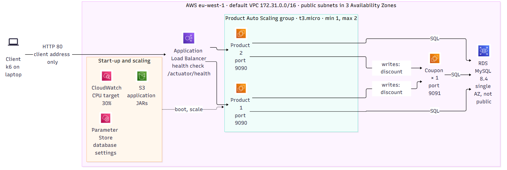
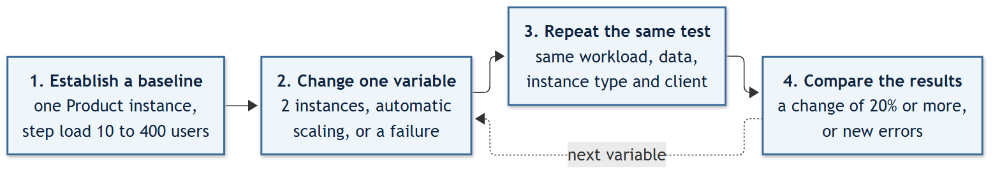
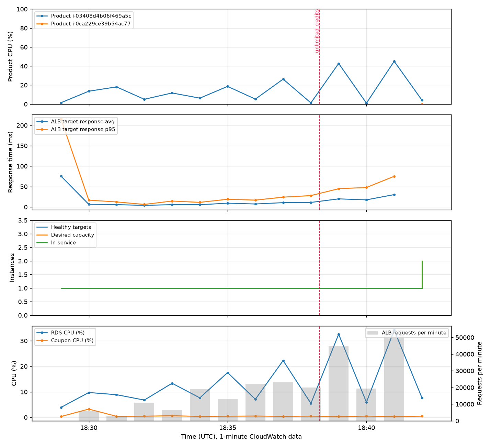
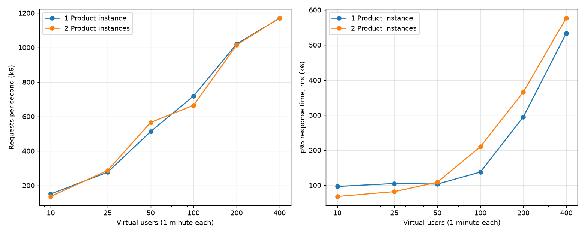
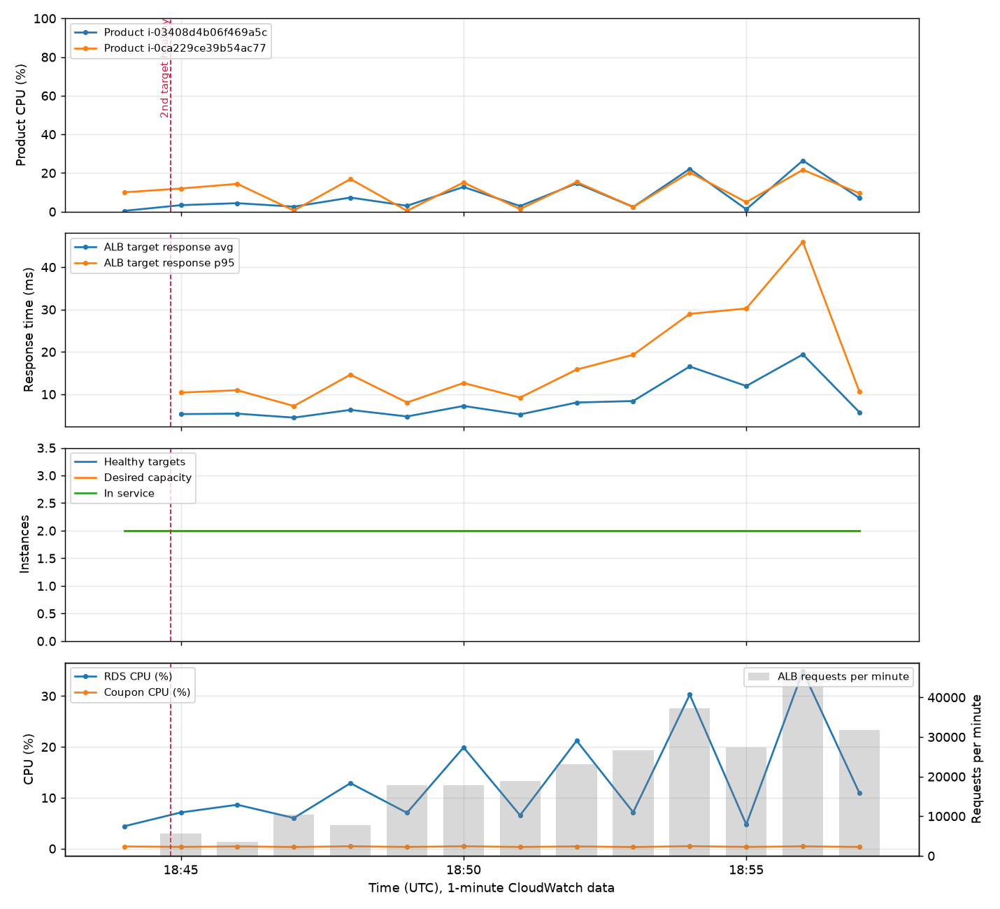
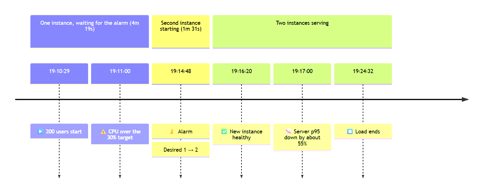
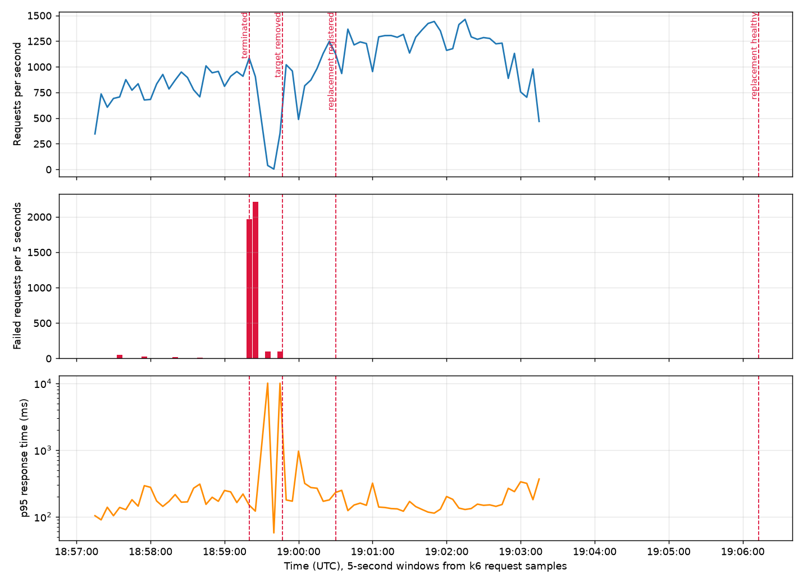
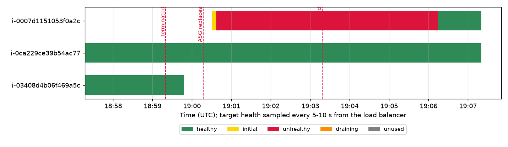
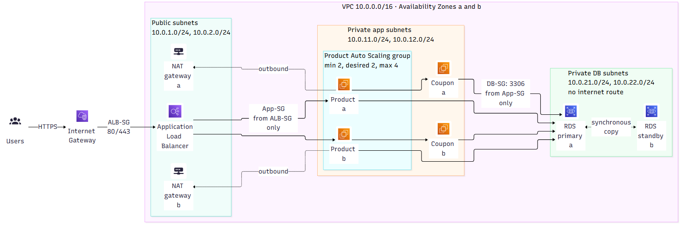

# Cloud Scalability and Resilience on AWS

<!-- title-page:start -->
<div align="center">

**Horizontal scaling of the Product-Coupon application**  

**Mark Crowe**  
MSc in Software Design with Cloud Computing  
Container Design and Deployment – CA1  
November 2026

> "~~Peace~~ ***Failure*** was never an option." – Magneto, *X-Men: First Class* trailer (2011), adapted

</div>
<!-- title-page:end -->

---

<!-- toc:start -->
**Contents**  

- [Overview](#overview)
- [Chapter 1: Problem and architecture](#chapter-1-problem-and-architecture)
  - [1.1 Problem](#11-problem)
  - [1.2 Deployed architecture](#12-deployed-architecture)
  - [1.3 Design decisions and rationale](#13-design-decisions-and-rationale)
    - [D1 Product is stateless](#d1-product-is-stateless)
    - [D2 One load balancer as the endpoint](#d2-one-load-balancer-as-the-endpoint)
    - [D3 Health check on the Actuator](#d3-health-check-on-the-actuator)
    - [D4 Deregistration delay of 30 seconds](#d4-deregistration-delay-of-30-seconds)
    - [D5 Launch template and Auto Scaling group across three zones](#d5-launch-template-and-auto-scaling-group-across-three-zones)
    - [D6 Start-up by user data instead of a custom image](#d6-start-up-by-user-data-instead-of-a-custom-image)
    - [D7 JARs in a private S3 bucket, read through an IAM role](#d7-jars-in-a-private-s3-bucket-read-through-an-iam-role)
    - [D8 Database settings in Parameter Store](#d8-database-settings-in-parameter-store)
    - [D9 Security groups in a chain](#d9-security-groups-in-a-chain)
    - [D10 Session Manager instead of SSH](#d10-session-manager-instead-of-ssh)
    - [D11 Coupon on a single instance](#d11-coupon-on-a-single-instance)
    - [D12 RDS in one zone, db.t3.micro](#d12-rds-in-one-zone-dbt3micro)
    - [D13 t3.micro for Product](#d13-t3micro-for-product)
- [Chapter 2: Experimental method](#chapter-2-experimental-method)
  - [2.1 Approach](#21-approach)
  - [2.3 Workloads](#23-workloads)
  - [2.2 Load profile](#22-load-profile)
    - [Workload 1: List products](#workload-1-list-products)
    - [Workload 2: Create products](#workload-2-create-products)
  - [2.3 Metrics](#23-metrics)
  - [2.4 Hypotheses](#24-hypotheses)
    - [H1: One instance reaches a limit](#h1-one-instance-reaches-a-limit)
    - [H2: Two instances serve more](#h2-two-instances-serve-more)
    - [H3: Writes gain less than reads](#h3-writes-gain-less-than-reads)
    - [H4: Scale-out takes minutes](#h4-scale-out-takes-minutes)
    - [H5: Failure causes a short burst](#h5-failure-causes-a-short-burst)
    - [H6: A stopped Coupon breaks writes](#h6-a-stopped-coupon-breaks-writes)
    - [H7: The database is shared](#h7-the-database-is-shared)
  - [2.5 Pilot run and what it changed](#25-pilot-run-and-what-it-changed)
    - [Consequences for the method](#consequences-for-the-method)
  - [2.6 Controls for a fair comparison](#26-controls-for-a-fair-comparison)
  - [2.7 Assumptions](#27-assumptions)
- [Chapter 3: Technical implementation](#chapter-3-technical-implementation)
  - [3.1 Requirements from the brief (B)](#31-requirements-from-the-brief-b)
    - [R1 Product communicates with its dependencies](#r1-product-communicates-with-its-dependencies)
    - [R2 A single client-facing endpoint](#r2-a-single-client-facing-endpoint)
    - [R3 Requests go to a healthy target](#r3-requests-go-to-a-healthy-target)
    - [R4 Instances are created the same way every time](#r4-instances-are-created-the-same-way-every-time)
    - [R5 State is kept outside the instances](#r5-state-is-kept-outside-the-instances)
    - [R6 Monitoring](#r6-monitoring)
    - [R7 Capacity adjusts automatically](#r7-capacity-adjusts-automatically)
  - [3.2 Selected configuration](#32-selected-configuration)
  - [3.3 Software used](#33-software-used)
    - [Applications](#applications)
    - [AWS](#aws)
    - [Data and charts](#data-and-charts)
    - [Diagrams and slides](#diagrams-and-slides)
    - [Load testing](#load-testing)
    - [Scripts](#scripts)
    - [Video](#video)
- [Chapter 4: Results and evidence](#chapter-4-results-and-evidence)
  - [4.1 Baseline (A): one Product instance](#41-baseline-a-one-product-instance)
  - [4.2 Horizontal scaling (C): two Product instances](#42-horizontal-scaling-c-two-product-instances)
  - [4.3 Elasticity (D)](#43-elasticity-d)
  - [4.4 Failure and recovery (E)](#44-failure-and-recovery-e)
  - [4.5 Whole system (F)](#45-whole-system-f)
- [Chapter 5: Engineering evaluation](#chapter-5-engineering-evaluation)
  - [5.1 Answer to the question](#51-answer-to-the-question)
  - [5.2 Bottlenecks and remaining single points of failure](#52-bottlenecks-and-remaining-single-points-of-failure)
    - [Client side (measured)](#client-side-measured)
    - [Client address](#client-address)
    - [Database (measured trend)](#database-measured-trend)
    - [Coupon (design)](#coupon-design)
    - [Start-up time and CPU credits (measured)](#start-up-time-and-cpu-credits-measured)
    - [Failure detection (measured)](#failure-detection-measured)
  - [5.3 Trade-offs](#53-trade-offs)
    - [Cost](#cost)
    - [Security](#security)
    - [Cost and complexity of the three-tier design](#cost-and-complexity-of-the-three-tier-design)
    - [Sustainability](#sustainability)
    - [Operational complexity](#operational-complexity)
  - [5.4 One next improvement: a three-tier design across two Availability Zones](#54-one-next-improvement-a-three-tier-design-across-two-availability-zones)
- [Chapter 6: References and use of AI](#chapter-6-references-and-use-of-ai)
  - [6.1 References](#61-references)
  - [6.2 Declaration of generative AI use](#62-declaration-of-generative-ai-use)
- [Glossary](#glossary)
- [Appendix A: Data sets](#appendix-a-data-sets)
<!-- toc:end -->

<!-- lof:start -->
**List of figures**  

1. [Figure 1: The architecture every result was measured on](#12-deployed-architecture)
2. [Figure 2: The method, one variable at a time](#21-approach)
3. [Figure 3: One instance during the step load, CloudWatch](#41-baseline-a-one-product-instance)
4. [Figure 4: One versus two instances, client throughput and p95](#42-horizontal-scaling-c-two-product-instances)
5. [Figure 5: Two instances during the step load, CloudWatch](#42-horizontal-scaling-c-two-product-instances)
6. [Figure 6: The elasticity events on one time line](#43-elasticity-d)
7. [Figure 7: Elasticity run, CloudWatch](#43-elasticity-d)
8. [Figure 8: Elasticity run, client view](#43-elasticity-d)
9. [Figure 9: The failure events on one time line](#44-failure-and-recovery-e)
10. [Figure 10: Failure test, client view](#44-failure-and-recovery-e)
11. [Figure 11: Failure test, target health](#44-failure-and-recovery-e)
12. [Figure 12: Target three-tier design](#54-one-next-improvement-a-three-tier-design-across-two-availability-zones)
<!-- lof:end -->

<!-- lot:start -->
**List of tables**  

1. [Table 1: Metrics by layer](#23-metrics)
2. [Table 2: One Product instance, step load](#41-baseline-a-one-product-instance)
3. [Table 3: One versus two Product instances](#42-horizontal-scaling-c-two-product-instances)
4. [Table 4: Elasticity events](#43-elasticity-d)
5. [Table 5: Elasticity, one instance and two](#43-elasticity-d)
6. [Table 6: Failure and recovery events](#44-failure-and-recovery-e)
7. [Table 7: Hypotheses and results](#51-answer-to-the-question)
8. [Table 8: Data sets](#appendix-a-data-sets)
<!-- lot:end -->

---

## Overview

> "If you build it, he will come." – The Voice, *Field of Dreams*, 1989

**Engineering question:** "To what extent does horizontally scaling the Product Service improve the scalability and resilience of the application, and what limitations remain elsewhere in the architecture?"

The Product-Coupon application was deployed on AWS behind a load balancer, with the Product service in an Auto Scaling group. One Product instance was measured, then two, then a group that scaled automatically, and one instance was deliberately terminated. Inside AWS, two instances halved the CPU per instance and cut the server-side p95 response time by 36-55%; the client on the laptop saw no gain, because the laptop and its network set the limit. Losing an instance cost about 30 seconds of errors, and full capacity took 6m 53s to return.

The experiments ran on November 9, 2026, between 18:00 and 19:30 UTC. Every figure in Chapter 4 is drawn from the saved k6 and CloudWatch data in [test-results](../test-results/) with [ca1_charts.py](../scripts/ca1_charts.py) and [ca1_compare_chart.py](../scripts/ca1_compare_chart.py). The notebook [make_charts.ipynb](../data/notebooks/make_charts.ipynb) shows the data and draws them too, and the numbers behind the charts are kept as data sets in [data](../data/readme.md) (Appendix A).

Supporting material: the [slides](screencast-deck/index.html) and their [narration](screencast-deck/speaking-script.md), and the [experiment and interpretation guide](ca1-experiment-guide.md). They contain no results beyond those in this report.

---

## Chapter 1: Problem and architecture

> "You're gonna need a bigger boat." – Chief Brody, *Jaws*, 1975

### 1.1 Problem

The application works locally. The organisation wants more people to use it, through the cloud, with demand that will grow and be hard to predict. The practical questions are: **how much load does it take to break it, what breaks first, and does adding Product instances move that limit?**

A single Product instance is both a capacity limit and a single point of failure. This investigation measures one Product instance, then two, then an automatically scaled group, and deliberately fails an instance, to find out what horizontal scaling of Product actually improves and what it leaves unchanged.

The application has three parts:

- **Product** (Spring Boot, port 9090): the workload under investigation. Reads list products from MySQL. Creating a product also calls Coupon synchronously.
- **Coupon** (Spring Boot, port 9091): a dependency of Product writes.
- **MySQL**: the shared data store for both services.

### 1.2 Deployed architecture



*Figure 1: The architecture every result was measured on. Mermaid source: [fig-01-as-deployed.mmd](report-images/mermaid/fig-01-as-deployed.mmd); the same design in AWS shapes is page 2 of [fig-01-architecture.drawio](report-images/fig-01-architecture.drawio).*

All resources are in `eu-west-1`, in the default VPC (172.31.0.0/16, three public subnets, no NAT gateway), and are created and deleted by scripts ([02](../aws-setup/scripts/02-create-network.ps1) to [13](../aws-setup/scripts/13-cleanup.ps1)). The security groups form a chain: the load balancer accepts port 80 only from the client's address range; Product accepts 9090 only from the load balancer; Coupon accepts 9091 from Product; RDS accepts 3306 only from Product and Coupon. The rules as the scripts created them are logged in [after-rebuild.txt](../test-results/20261110-002806-ca1-rebuild/after-rebuild.txt) ("Security groups" and "Ingress rules").

### 1.3 Design decisions and rationale

Each decision is followed by the reason for it and the trade-off accepted. The numbers (D1 to D13) are used for cross-references.

#### D1 Product is stateless

All state is in RDS, so any Product instance can serve any request, and instances can be added, removed or replaced freely (brief section 3).

**Trade-off:** every instance shares one database.

#### D2 One load balancer as the endpoint

An Application Load Balancer is the single endpoint. Normal client traffic uses one address, and requests go only to targets that pass their health checks.

**Trade-off:** extra cost and an extra network hop. If every registered target is unhealthy, the load balancer can fail open and route to them anyway (Amazon Web Services, n.d.d).

#### D3 Health check on the Actuator

The health check is `/actuator/health`, every 10 s, 2 healthy and 2 unhealthy, with a 5 s timeout. A failed instance is removed from routing after about 20 s. The Actuator health includes the database connection, so an instance that cannot reach RDS is also removed.

**Trade-off:** a database outage marks every instance unhealthy at once ([H7](#h7-the-database-is-shared)).

#### D4 Deregistration delay of 30 seconds

The default is 300 s. With 30 s, requests in flight still finish, but the scale-in and failure experiments do not wait 5 minutes.

**Trade-off:** very long requests could be cut off; none exist in this application.

#### D5 Launch template and Auto Scaling group across three zones

Product instances are identical and repeatable, and a failed instance is replaced automatically.

**Trade-off:** start-up time limits how fast capacity appears.

#### D6 Start-up by user data instead of a custom image

A user data script installs Java, copies the JAR from S3 and starts a systemd service. Each change needs one artifact (the JAR), and there is no image to rebuild.

**Trade-off:** about 2.5 minutes from launch to a healthy target, measured; a pre-built image would be faster.

#### D7 JARs in a private S3 bucket, read through an IAM role

No long-lived access keys are embedded in the application or the user data; the instance role supplies temporary credentials.

**Trade-off:** an IAM role and policy to maintain.

#### D8 Database settings in Parameter Store

The password is a SecureString. The same artifact works in every environment, and the secret is not in the JAR, the launch template or the repository.

**Trade-off:** instances need permission to read Systems Manager parameters at boot.

#### D9 Security groups in a chain

Load balancer, then Product, then Coupon and RDS, with outside access limited to one client address range. RDS is not publicly accessible. The load balancer, and Product and Coupon directly (for diagnostics and the Coupon tests), accept only the client's address range.

**Trade-off:** the client range must be updated when it changes. That happened during the pilot, and on November 10 it stopped the H3 and H6 runs ([5.2](#client-address)). Direct instance access is a diagnostic convenience that a production design would remove.

#### D10 Session Manager instead of SSH

No port 22 is open and there are no key pairs to manage.

**Trade-off:** depends on the Systems Manager agent and role.

#### D11 Coupon on a single instance

Product is the workload under investigation (brief section 2).

**Trade-off:** Coupon is a known single point of failure for writes.

#### D12 RDS in one zone, db.t3.micro

Cost and time stay within an academic budget.

**Trade-off:** the database is a single point of failure for the whole application.

#### D13 t3.micro for Product

The cheapest instance size, which makes saturation reachable with a modest load.

**Trade-off:** burstable CPU in `standard` credit mode. When the credit balance runs out, CPU is capped (Amazon Web Services, n.d.b), so the balance is recorded with every run.

---

## Chapter 2: Experimental method

> "Insufficient facts always invite danger." – Spock, *Star Trek*, "Space Seed", 1967

### 2.1 Approach

Establish a baseline, change one variable, repeat the same test, compare the results (Figure 2). The predictions in [2.4](#24-hypotheses) were first committed to the repository on October 19, 2026, before the experiments on November 9, so the git history shows they were not adjusted to fit the results.



*Figure 2: The method, one variable at a time. Mermaid source: [fig-03-method.mmd](report-images/mermaid/fig-03-method.mmd).*

### 2.3 Workloads

| ID | Request                      | Path through the system         | Why                                                                                            |
|----|------------------------------|---------------------------------|------------------------------------------------------------------------------------------------|
| W1 | `GET /product-api/products`  | ALB -> Product -> RDS           | Excludes Coupon while retaining Product and database work                                      |
| W2 | `POST /product-api/products` | ALB -> Product -> Coupon -> RDS | Shows whether the single Coupon instance and the database limit the benefit of scaling Product |

### 2.2 Load profile

Load is generated with Grafana k6 using the existing [product-read.js](../aws-setup/load-test/product-read.js) and [product-write.js](../aws-setup/load-test/product-write.js) scripts in [aws-setup/load-test](../aws-setup/load-test/). Each run saves a JSON summary with request rate, error rate and response time percentiles. The p95 response time is the 95th percentile: 95% of requests were faster than this time, and p99 likewise for 99% (Amazon Web Services, n.d.c; Grafana Labs, n.d.). Correctness checks are read alongside request rate, so fast failures are not reported as useful throughput.

#### Workload 1: List products

`GET /product-api/products`, through the load balancer to Product and RDS. It leaves out Coupon but keeps Product and database work.

**Used on November 9, 2026, for every run.** A closed loop: each virtual user sends the next request as soon as the previous one returns, with no think time. Step load of 10, 25, 50, 100, 200 and 400 virtual users, 1 minute per level, with a 60 s pause between levels so each level falls in its own CloudWatch minutes, after an unrecorded 15 s warm-up. The data set was fixed at 20 products (2,663 bytes per response). The client was the laptop for every run.

#### Workload 2: Create products

`POST /product-api/products`, through the load balancer to Product, Coupon and RDS. It shows whether the single Coupon instance and the database limit the benefit of scaling Product.

**Not run under load in the time available.** Product creation was checked once per product while seeding the 20 rows (each priced 100, stored as 90 after the Coupon discount). [H3](#h3-writes-gain-less-than-reads) and [H6](#h6-a-stopped-coupon-breaks-writes) are evaluated from design and the local evidence.

### 2.3 Metrics

*Table 1: Metrics by layer*  

| Layer         | Metric                                                                                                          | Source                                                         |
|---------------|-----------------------------------------------------------------------------------------------------------------|----------------------------------------------------------------|
| Client        | Error rate; p95 and p99 response time; requests per second                                                      | k6 summary                                                     |
| Dependencies  | Coupon CPU; RDS CPU and `DatabaseConnections`                                                                   | CloudWatch (EC2, RDS)                                          |
| Load balancer | `HealthyHostCount`, `HTTPCode_ELB_5XX_Count`, `HTTPCode_Target_5XX_Count`, `RequestCount`, `TargetResponseTime` | CloudWatch (ALB, target group)                                 |
| Product       | CPU credit balance; CPU utilisation per instance                                                                | CloudWatch (EC2, 1-minute detailed monitoring)                 |
| Scaling       | Desired and in-service capacity; scaling activity times                                                         | CloudWatch (ASG group metrics, 1-minute), ASG activity history |

Memory use was not measured. EC2 does not publish memory metrics by default; they need the CloudWatch agent, which was not installed.

Two kinds of response time are reported in Chapter 4. **Client p95** is measured by k6 on the laptop and includes the network. **Server p95** is the load balancer's `TargetResponseTime` p95 in CloudWatch, the time from the load balancer to Product and back, so it excludes the client's network.

### 2.4 Hypotheses

The hypotheses follow the quantitative form used in the Research Methods and Professional Practice module (Creswell and Creswell, 2018): independent variable first, dependent variable last, a null hypothesis (H0, no difference) and a directional alternative (HA). This section restates the October 19 predictions in that form without changing their direction.

- **Independent variables:** offered load (virtual users); number of Product instances (1 or 2); automatic scaling (off or on); deliberate failure (Product instance terminated, Coupon stopped).
- **Dependent variables:** throughput (requests/s), p95 response time (ms), error rate (%), time until new capacity is a healthy target (minutes).
- **Controlled variables:** instance type and credit mode, workload script, users, duration, data set size, client location ([2.6](#26-controls-for-a-fair-comparison)).

Each configuration is run once, so no significance test is possible. H0 is rejected when the measured difference is at least 20% for throughput or p95, or when errors appear where there were none. The 20% threshold was chosen before the runs as larger than the variation expected between short runs from the same client.

#### H1: One instance reaches a limit

- **H0:** increasing offered load from 10 to 100 users does not change the throughput or p95 of one Product instance on Workload 1.
- **HA:** beyond a saturation point, throughput stops rising and p95 rises, with Product CPU high.
- **Test:** step load, Workload 1, one instance ([4.1](#41-baseline-a-one-product-instance)).

#### H2: Two instances serve more

- **H0:** there is no difference between one and two Product instances in Workload 1 throughput or p95 at the same load.
- **HA:** two instances give higher throughput (towards 2x) and lower p95 at the same load, if Product CPU is the limit.
- **Test:** Workload 1 with two instances, against H1 ([4.2](#42-horizontal-scaling-c-two-product-instances)).

#### H3: Writes gain less than reads

- **H0:** adding a second Product instance changes Workload 2 (writes) by the same amount as Workload 1 (reads).
- **HA:** adding a second instance improves writes less than reads, because every write also waits on the single Coupon instance and the single database.
- **Test:** Workload 2, one against two instances (not run, [4.5](#45-whole-system-f)).

#### H4: Scale-out takes minutes

- **H0:** with automatic scaling, p95 during a load increase is no different from steady state, and new capacity is healthy within one minute.
- **HA:** new capacity takes several minutes to become healthy after the load increase, and p95 is higher during that time.
- **Test:** elasticity run with a CloudWatch timeline ([4.3](#43-elasticity-d)).

#### H5: Failure causes a short burst

- **H0:** terminating one of two Product instances causes no errors and no change in p95.
- **HA:** termination causes a short burst of errors or slow responses (seconds, not minutes); traffic continues on the remaining instance; a replacement is healthy within 3-5 minutes.
- **Test:** failure run ([4.4](#44-failure-and-recovery-e)).

#### H6: A stopped Coupon breaks writes

- **H0:** stopping Coupon does not change the error rate of Workload 1 or Workload 2.
- **HA:** stopping Coupon makes writes fail while reads keep working, whatever the number of Product instances.
- **Test:** stop Coupon during Workload 1 and Workload 2 (locally only, [4.5](#45-whole-system-f)).

#### H7: The database is shared

- **H0:** stopping the database affects Product instances independently.
- **HA:** the single-zone RDS instance is a single point of failure for every Product instance at once.
- **Test:** design analysis; an optional RDS reboot was not run ([4.5](#45-whole-system-f)).

### 2.5 Pilot run and what it changed

A one-minute pilot with 10 virtual users against one instance (October 19, 2026) gave 228 requests/s, 0% errors and p95 63.8 ms. The minimum observed response time was 24 ms from the laptop on a mobile connection. This end-to-end value does not isolate network delay. The pilot showed that the workload could run; without a controlled load series and supporting CPU and credit evidence, it did not show server capacity.

#### Consequences for the method

The pilot changed the plan in two ways. First, a step load (10, 25, 50, 100 users and more) on one instance would find the saturation point before the baseline load was fixed, instead of guessing a single load. Second, because so much of the response time could be the client's network, k6 was planned to run from two places, the laptop first and then an EC2 instance in `eu-west-1`, to compare client environments (location and hardware; this does not isolate network latency alone). Only the laptop runs were done in the time available ([5.4](#54-one-next-improvement-a-three-tier-design-across-two-availability-zones)).

### 2.6 Controls for a fair comparison

1. The same workload script, users, duration and client location for every compared run.
2. The same data set size: Workload 1 returns every product, so the product count is recorded before each run (writes from Workload 2 make later reads larger).
3. The same instance type (t3.micro) and CPU credit mode, with the credit balance checked before each run.
4. Only the number of Product instances changes between the baseline (A) and the scaling run (C).
5. The start and end time of every run recorded, so CloudWatch graphs can be matched to k6 results. Run log: [ca1-progress.md](ca1-progress.md) section 8.

### 2.7 Assumptions

The comparisons rest on three assumptions:

1. The load generator is not itself the bottleneck (its CPU and network are checked during runs).
2. Results on t3.micro reflect the recorded CPU credit mode.
3. Runs are short; long-term effects (memory growth, credit exhaustion over hours) are out of scope.

---

## Chapter 3: Technical implementation

> "You think that kind of automation is easy? Or cheap?" – Dennis Nedry, *Jurassic Park*, 1993

The architecture in [1.2](#12-deployed-architecture) is built by PowerShell scripts that call the AWS CLI ([aws-setup/scripts](../aws-setup/scripts/)), so every experiment starts from the same configuration and can be torn down to stop costs. The Product tier is changed between experiments with one script: [08-configure-auto-scaling.ps1](../aws-setup/scripts/08-configure-auto-scaling.ps1) `-Min -Desired -Max -Policy`.

### 3.1 Requirements from the brief (B)

Part B of the brief, design for horizontal scalability, is answered here by the deployment itself rather than by a load test.

#### R1 Product communicates with its dependencies

On November 7, a Product write through the load balancer applied a 10-unit Coupon discount and stored the price of 90. A later read returned the same row. The Coupon fixture was created on its own instance through Systems Manager, after direct public requests from the laptop timed out.

Evidence: [smoke check](../test-results/20261107-182351-ca1-aws/smoke-check.json) and [deployment transcript](../test-results/20261107-182351-ca1-aws/deployment.txt).

#### R2 A single client-facing endpoint

The load balancer listens on port 80 and forwards to the Product target group. Every k6 run in Chapter 4 used the one load balancer address.

#### R3 Requests go to a healthy target

The target group showed one healthy Product instance on November 7. Both instances carried similar CPU in the two-instance runs ([4.2](#42-horizontal-scaling-c-two-product-instances)).

Evidence: [target health screenshot](report-images/fig-04-target-group-health.png) and [capture record](../test-results/20261107-182351-ca1-aws/product-target-health-capture.json).

#### R4 Instances are created the same way every time

A launch template (Amazon Linux 2023, t3.micro, instance role, user data) and an Auto Scaling group across three Availability Zones. Three instances were launched automatically on November 9: the scale to two, the failure replacement and the scale-out.

Evidence: [asg-activities.json](../test-results/20261109-185653-laptop-failure-2product-100users/asg-activities.json) (failure) and [asg-activities.json](../test-results/20261109-191012-laptop-elasticity-1to2-cpu30-200users/asg-activities.json) (elasticity).

#### R5 State is kept outside the instances

RDS MySQL 8.4, not publicly accessible, reachable only from the Product and Coupon security groups. The 20 products stayed the same across instance changes.

Evidence: rebuild transcript [deployment.txt](../test-results/20261109-180012-ca1-rebuild/deployment.txt).

#### R6 Monitoring

EC2 detailed monitoring (1-minute), Auto Scaling group metrics (1-minute), and load balancer and RDS metrics. The CloudWatch graphs in Chapter 4 come from them.

#### R7 Capacity adjusts automatically

Target tracking on average Auto Scaling group CPU at 30%, minimum 1, maximum 2 (Amazon Web Services, n.d.g); the target is justified in [4.3](#43-elasticity-d).

Evidence: [console, one healthy target before scale-out](report-images/fig-18-console-elasticity-one-target.png) and [elasticity-config.txt](../test-results/20261109-180012-ca1-rebuild/elasticity-config.txt).

### 3.2 Selected configuration

From [deployment.env.example](../aws-setup/deployment.env.example) and scripts [06](../aws-setup/scripts/06-create-load-balancer.ps1) and [07](../aws-setup/scripts/07-deploy-product.ps1):

<!-- keep-together -->
```text
Instance type            t3.micro (Product, Coupon), db.t3.micro (RDS)
Health check             /actuator/health, interval 10 s, timeout 5 s, healthy 2, unhealthy 2
Deregistration delay     30 s
ASG health check type    ELB, grace period 300 s
Default instance warm-up 180 s
JVM                      -XX:MaxRAMPercentage=60
```

The default instance warm-up tells Auto Scaling how long a new instance needs before its metrics count towards the group's average (Amazon Web Services, n.d.f). Measured start-up: the first Product instance became a healthy target about 2.5 minutes after the Auto Scaling group was created (boot, Java install, JAR download, Spring start, two passed health checks).

### 3.3 Software used

#### Applications

- Amazon Linux 2023 with Amazon Corretto (Java 17): operating system and Java runtime on the instances ([user-data-service.sh](../aws-setup/linux/user-data-service.sh))
- Docker: running the whole system locally before AWS ([docker-local](../docker-local/readme.md))
- Spring Boot 4.1.1: the Product and Coupon services

#### AWS

- Amazon Web Services, region eu-west-1: Application Load Balancer (ALB), CloudWatch, EC2, EC2 Auto Scaling, RDS for MySQL 8.4, Systems Manager
- AWS CLI 2.38 (Command Line Interface): every AWS resource is created, changed and deleted from the command line

#### Data and charts

- Jupyter, matplotlib 3.11, pandas 3.0 and Python 3.14: summaries and charts from the saved results ([make_charts.ipynb](../data/notebooks/make_charts.ipynb))

#### Diagrams and slides

- Apache ECharts 5.5: the slides' interactive charts
- Mermaid 12.3: the diagrams and timelines
- Reveal.js 5.1: the slides ([screencast deck](screencast-deck/README.md))

#### Load testing

- Grafana k6 2.2: load generation from the laptop ([ca1-run-k6.ps1](../aws-setup/scripts/ca1-run-k6.ps1))

#### Scripts

- PowerShell 7.6: the deployment, experiment and cleanup scripts ([aws-setup/scripts](../aws-setup/scripts/))

#### Video

- ffmpeg 8.1: putting the screencast together ([recording](screencast-deck/recording/readme.md))

---

## Chapter 4: Results and evidence

> "Why do we fall, Bruce? So we can learn to pick ourselves up." – Thomas Wayne, *Batman Begins*, 2005

The letters in the section titles follow the parts of the brief's investigation: A baseline, B design for horizontal scalability, C effect of scaling, D elasticity, E failure and recovery, F whole system. Part B is about the design, not a measurement, so it is answered in [3.1](#31-requirements-from-the-brief-b); the other five parts are measured here.

<!--Did you mean to delete this?-->
 Two kinds of response time are reported. **Client p95** is measured by k6 on the laptop and includes the network. **Server p95** is the ALB `TargetResponseTime` p95, the time from the load balancer to Product and back, so it excludes the client's network.
<!-- -->

All runs: November 9, 2026, Workload 1 from the laptop, 20 products, t3.micro. CPU values are the highest 1-minute CloudWatch average during the level. Evidence: `test-results/20261109-*-laptop-read-*` (k6 summary, console output, start and end times) and [metrics.json](../test-results/20261109-184043-laptop-read-1product-400users/metrics.json) (1 instance) and [metrics.json](../test-results/20261109-185537-laptop-read-2product-400users/metrics.json) (2 instances).

Change of method during the run: at 100 users the Product CPU credit balance was 0.88 and falling, with CPU above the 10% t3.micro baseline. In `standard` mode the instance would soon have been held at 10% CPU, so the higher levels would have measured the credit cap instead of Product. Both Product instances were switched to `unlimited` at 18:38 UTC, before the 200-user level ([credit-mode-change.txt](../test-results/20261109-180012-ca1-rebuild/credit-mode-change.txt); Amazon Web Services, n.d.b). Every two-instance run used `unlimited`.

### 4.1 Baseline (A): one Product instance

*Table 2: One Product instance, step load*  

| Users | Requests/s | Client p95 (ms) | Errors | Server p95 (ms) | Product CPU | RDS CPU |
|------:|-----------:|----------------:|-------:|----------------:|------------:|--------:|
|    10 |        151 |              97 |  0.04% |              12 |         18% |     10% |
|    25 |        277 |             105 |  0.13% |              14 |         12% |     13% |
|    50 |        513 |             103 |  0.12% |              19 |         19% |     18% |
|   100 |        720 |             137 |  0.24% |              24 |         26% |     22% |
|   200 |      1,020 |             295 |  0.27% |              45 |         43% |     33% |
|   400 |      1,170 |             534 |  0.50% |              75 |         45% |     34% |



*Figure 3: One instance during the step load. Product CPU, load balancer response time, capacity, RDS CPU and requests per minute on one UTC axis.*

Throughput rose almost in proportion to users up to 200 users, then only 15% more from 200 to 400 users while client p95 nearly doubled. That is the shape [H1](#h1-one-instance-reaches-a-limit) predicted. But Product CPU stayed at or below 45%, and the server p95 stayed at or below 75 ms while the client p95 reached 534 ms. Most of each response time was therefore spent outside AWS, between the laptop and the load balancer. The small error rate (0.04-0.50%) was TCP connection timeouts on the laptop (`dial tcp ... connectex`); the load balancer recorded no 5XX responses. **H1: partly supported.** A limit was reached at 200-400 users, but the evidence points to the client and its network, not Product CPU.

### 4.2 Horizontal scaling (C): two Product instances

<!-- table-groups: Users | Requests per second:2 | Client p95 (ms):2 | Server p95 (ms):2 | Product CPU:2 -->
*Table 3: One versus two Product instances (1 and 2 are the number of instances)*  

| Users | Requests/s, 1 instance | Requests/s, 2 instances | Client p95 (ms), 1 instance | Client p95 (ms), 2 instances | Server p95 (ms), 1 instance | Server p95 (ms), 2 instances | Product CPU, 1 instance | Product CPU, 2 instances (each) |
|------:|-----------------------:|------------------------:|----------------------------:|-----------------------------:|----------------------------:|-----------------------------:|------------------------:|--------------------------------:|
|    10 |                    151 |                     136 |                          97 |                           68 |                          12 |                           11 |                     18% |                      4% and 14% |
|    25 |                    277 |                     287 |                         105 |                           82 |                          14 |                           15 |                     12% |                      7% and 17% |
|    50 |                    513 |                     566 |                         103 |                          108 |                          19 |                           13 |                     19% |                     13% and 15% |
|   100 |                    720 |                     665 |                         137 |                          210 |                          24 |                           16 |                     26% |                     15% and 15% |
|   200 |                  1,020 |                   1,014 |                         295 |                          366 |                          45 |                           29 |                     43% |                     22% and 20% |
|   400 |                  1,170 |                   1,171 |                         534 |                          577 |                          75 |                not published |                     45% |                     26% and 22% |

The two figures in the last column are the two Product instances, each measured on its own.



*Figure 4: One versus two instances: client throughput and p95 against users.*



*Figure 5: Two instances during the same step load. The second instance became a healthy target at 18:44:49, 2m 52s after the desired capacity was raised to 2.*

Throughput with two instances stayed within 10% of one instance at every level and was identical at 400 users (1,170 and 1,171 requests/s). The 20% threshold was not crossed for throughput. Client p95 was 30% lower at 10 users but 24-53% higher at 100 and 200 users; with one run per level this is within the variation of the laptop's connection, not an effect of the second instance. On the server side the change was clear: CPU per instance roughly halved (43% to 22% and 20% at 200 users) and server p95 fell from 45 to 29 ms at 200 users (36% lower). Both instances carried similar CPU, which indicates that the load balancer spread requests across them; per-request logs were not collected. **[H2](#h2-two-instances-serve-more): not supported for the client.** Scaling Product reduced Product's own work per instance, but the client-visible limit was outside Product. The two-instance server p95 at 400 users was not yet published by CloudWatch when the metrics were exported.

### 4.3 Elasticity (D)

Configuration: minimum 1, desired 1, maximum 2, target tracking on average Auto Scaling group CPU at **30%** (Amazon Web Services, n.d.g). The target was chosen from the baseline: one instance reached 43-45% CPU at 200-400 users, so 30% should trigger a scale-out under that load while staying above the 10-26% seen at low load. The launch template was switched to `unlimited` credits first ([4.4](#44-failure-and-recovery-e)). Load: 200 users for 14 minutes from one healthy instance. Evidence: [test-results/20261109-191012-laptop-elasticity-1to2-cpu30-200users](../test-results/20261109-191012-laptop-elasticity-1to2-cpu30-200users) ([events.txt](../test-results/20261109-191012-laptop-elasticity-1to2-cpu30-200users/events.txt), [health.csv](../test-results/20261109-191012-laptop-elasticity-1to2-cpu30-200users/health.csv), [samples.json.gz](../test-results/20261109-191012-laptop-elasticity-1to2-cpu30-200users/samples.json.gz), [metrics.json](../test-results/20261109-191012-laptop-elasticity-1to2-cpu30-200users/metrics.json), [asg-activities.json](../test-results/20261109-191012-laptop-elasticity-1to2-cpu30-200users/asg-activities.json)).

*Table 4: Elasticity events*  

| Time (UTC) | Elapsed | Event                                                                   |
|------------|--------:|-------------------------------------------------------------------------|
| 19:10:29   |  0m 00s | Load increased (200 users)                                              |
| 19:11:00   |  0m 31s | CPU above the 30% target (1-minute average 56%)                         |
| 19:14:48   |  4m 19s | Alarm `AlarmHigh` in state ALARM; desired capacity 1 to 2               |
| 19:14:49   |  4m 20s | New instance launched                                                   |
| 19:16:20   |  5m 51s | New target healthy (1m 31s after launch)                                |
| 19:17:00   |  6m 31s | Server response time back to a steady level (1-minute CloudWatch point) |
| 19:24:32   | 14m 03s | Load ended; scale-in not observed (stack deleted at 19:27)              |



*Figure 6: The elasticity events on one time line (UTC), as on the slides. Mermaid source: [fig-19-elasticity-events.mmd](report-images/mermaid/fig-19-elasticity-events.mmd).*


*Figure 7: Elasticity run. Product CPU per instance, load balancer response time, desired, in-service and healthy capacity, and RDS CPU on one UTC axis.*


*Figure 8: Elasticity run, client view: requests per second, failed requests and p95 in 10-second windows.*

*Table 5: Elasticity, one instance and two*  

| Period            | Instances | Client requests/s | Client p95 (ms) | Server p95 (ms) |   Product CPU | RDS CPU |
|-------------------|----------:|------------------:|----------------:|----------------:|--------------:|--------:|
| 19:11:30-19:14:48 |         1 |             1,442 |             361 |           56-66 |        56-64% |  44-48% |
| 19:16:30-19:24:30 |         2 |             1,538 |             367 |           24-30 | 31-37% (each) |  41-46% |

Most of the delay was the policy, not the instance. CPU was above the target from the first full minute, but the alarm fired only after 4m 19s. The new instance then took 1m 31s from launch to a healthy target, much faster than the throttled replacement in [4.4](#44-failure-and-recovery-e). In the minute the new instance joined, the server p95 rose to 131 ms and its CPU to 74%: a cold JVM received traffic straight away. After scale-out the server p95 fell by about 55% (from about 60 ms to about 27 ms) and CPU per instance settled at 31-37%, just above the target, with the group at its maximum of 2. As in [4.2](#42-horizontal-scaling-c-two-product-instances), the client gained little: 7% more requests per second and the same p95. **[H4](#h4-scale-out-takes-minutes): supported.** Useful capacity arrived almost 6 minutes after the load increase, and response time was worse during that time on the server side. Scale-in was not observed because the stack was deleted after the run. The client run happened to reach a higher request rate (1,442 requests/s on one instance) than the step load at 200 users (1,020), which shows how much the laptop's connection varied between runs.

### 4.4 Failure and recovery (E)

Two healthy instances, 100 users for 6 minutes from 18:57:17 UTC. At 18:59:20 one instance (`i-03408d4b06f469a5c`) was terminated with the EC2 API. Desired capacity stayed at 2. Target health was sampled every 5 s. Evidence: [test-results/20261109-185653-laptop-failure-2product-100users](../test-results/20261109-185653-laptop-failure-2product-100users) ([events.txt](../test-results/20261109-185653-laptop-failure-2product-100users/events.txt), [health.csv](../test-results/20261109-185653-laptop-failure-2product-100users/health.csv), [samples.json.gz](../test-results/20261109-185653-laptop-failure-2product-100users/samples.json.gz), [metrics.json](../test-results/20261109-185653-laptop-failure-2product-100users/metrics.json), [asg-activities.json](../test-results/20261109-185653-laptop-failure-2product-100users/asg-activities.json)).

*Table 6: Failure and recovery events*  

| Time (UTC) | Elapsed | Event                                                                                 |
|------------|--------:|---------------------------------------------------------------------------------------|
| 18:59:20   |  0m 00s | Instance terminated; 4,180 failed requests (connection errors) in the next 10 seconds |
| 18:59:30   |  0m 10s | Throughput near zero for 20 seconds; requests waited up to 10 seconds                 |
| 18:59:47   |  0m 27s | Terminated target no longer listed by the load balancer                               |
| 18:59:50   |  0m 30s | Throughput back above 1,000 requests/s on the remaining instance (time approximate)   |
| 19:00:17   |  0m 57s | Auto Scaling detected the terminated instance and started a replacement               |
| 19:00:30   |  1m 10s | Replacement registered (`initial`, then `unhealthy` while starting)                   |
| 19:06:13   |  6m 53s | Replacement healthy; two healthy targets again                                        |


*Figure 9: The failure events on one time line (UTC), as on the slides. Mermaid source: [fig-20-failure-events.mmd](report-images/mermaid/fig-20-failure-events.mmd).*



*Figure 10: Failure test, client view: requests per second, failed requests and p95 in 5-second windows. Dashed lines: termination, target removed, replacement registered and healthy.*



*Figure 11: Failure test, target health of each Product instance.*

**In the first 10 seconds, there were 4,180 failed requests; the service was back to normal on one instance after about 30 seconds.** The whole 6-minute run had 351,652 requests with 4,490 failures (1.3%), and 4,377 of them fell in the 30 seconds after the termination. The load balancer kept the terminated target in its list for 27 seconds, so requests were still sent to an instance that no longer existed until the health checks took it out (Amazon Web Services, n.d.d). The remaining instance then carried the full load at 52-56% CPU without errors. **[H5](#h5-failure-causes-a-short-burst): supported for the client** (an error burst of seconds, then service continued) **and not supported for replacement time**: the replacement took 6m 53s from the termination, longer than the predicted 3-5 minutes.

The reason is in the metrics. The replacement was launched from the launch template in `standard` credit mode with no credits: its CPU stayed at exactly 10.0% (the t3.micro baseline) from 19:01 to 19:05, so installing Java and starting Spring Boot ran at the throttled rate. It took 5m 54s from launch to healthy, against 2m 52s for the second instance launched at 18:41. Burstable instances with `standard` credits therefore slow down recovery and scale-out exactly when new capacity is needed (Amazon Web Services, n.d.b). Before the elasticity run the launch template was changed to `unlimited`.

### 4.5 Whole system (F)

- **Database:** RDS CPU rose with load to 33-34% at 200-400 users, and to 40-42% during the failure test (one instance serving about 1,300 requests/s). It held 20 connections throughout (10 from each service's default connection pool). It was not saturated, but its CPU grew faster than each Product instance's once Product was scaled, so it is the next AWS-side limit for reads. Every Product instance shares this single-zone database ([H7](#h7-the-database-is-shared), design analysis; not tested by an outage).
- **Coupon:** CPU stayed below 4% because Workload 1 does not call it. Under load it was not measured (Workload 2 not run). Locally, with Coupon stopped, `GET /product-api/products` returned 200 and `POST /product-api/products` returned 500 within about 30 ms ([04-test-local-coupon-stopped.txt](../test-results/2026-10-15-local-docker/04-test-local-coupon-stopped.txt)). An AWS run of H6 and H3 was prepared for November 10 ([ca1-h6-coupon-stop.ps1](../aws-setup/scripts/ca1-h6-coupon-stop.ps1), and [ca1-run-k6.ps1](../aws-setup/scripts/ca1-run-k6.ps1) `-Workload write`), but the rebuild's checks failed because the client's public address kept changing ([5.2](#client-address)) and the stack was deleted unused ([after-rebuild.txt](../test-results/20261110-002806-ca1-rebuild/after-rebuild.txt)). **[H6](#h6-a-stopped-coupon-breaks-writes): supported locally, not repeated on AWS.** **[H3](#h3-writes-gain-less-than-reads): not tested.**
- **Direct access to Coupon:** public requests from the laptop to Coupon port 9091 timed out on November 7 and 9, while Product reached Coupon privately. The 20 seed products were created through the load balancer and each stored the discounted price, which confirms the private Product to Coupon to RDS path.
- **Client:** the laptop and its network limited the comparison. Server p95 was 5-15% of client p95. A load generator inside eu-west-1 is needed to measure Product's own limit.

---

## Chapter 5: Engineering evaluation

> "Believing oneself to be perfect is often the sign of a delusional mind." – Lieutenant Commander Data, 2373

### 5.1 Answer to the question

**Scalability.** Horizontally scaling Product did what it should inside AWS: with two instances, CPU per instance halved and the server-side p95 fell by 36-55% ([4.2](#42-horizontal-scaling-c-two-product-instances) and [4.3](#43-elasticity-d)). It did **not** improve what the client measured: throughput stayed within 10% (identical at 400 users) and client p95 did not improve. Under these conditions the client and its network, not Product, set the limit. The investigation therefore shows that adding Product instances improves Product's headroom, but cannot show the full benefit until the load comes from somewhere with less delay than the laptop.

**Resilience.** A second instance made the service survive the loss of one instance: in the first 10 seconds there were 4,180 failed requests, and the remaining instance carried the whole load without errors after about 30 seconds ([4.4](#44-failure-and-recovery-e)). It did not make failure invisible: the load balancer kept sending requests to the terminated instance for 27 seconds, and full capacity took 6m 53s to return. Automatic scaling added capacity, but only about 6 minutes after the load rose ([4.3](#43-elasticity-d)).

*Table 7: Hypotheses and results*  

| Hypothesis                                                               | Result                                                                                                                            |
|--------------------------------------------------------------------------|-----------------------------------------------------------------------------------------------------------------------------------|
| [H1: One instance reaches a limit](#h1-one-instance-reaches-a-limit)     | Partly supported: throughput levelled off at 200-400 users, but Product CPU stayed at or below 45%; the limit was the client side |
| [H2: Two instances serve more](#h2-two-instances-serve-more)             | Not supported for the client (H0 not rejected: under 20% change); supported on the server side (CPU halved, server p95 -36%)      |
| [H3: Writes gain less than reads](#h3-writes-gain-less-than-reads)       | Not tested (Workload 2 not run under load)                                                                                        |
| [H4: Scale-out takes minutes](#h4-scale-out-takes-minutes)               | Supported: 5m 51s from load increase to healthy target                                                                            |
| [H5: Failure causes a short burst](#h5-failure-causes-a-short-burst)     | Supported for the error burst (about 30 s); not for the replacement (6m 53s, slowed by standard CPU credits)                      |
| [H6: A stopped Coupon breaks writes](#h6-a-stopped-coupon-breaks-writes) | Supported locally only; not repeated on AWS                                                                                       |
| [H7: The database is shared](#h7-the-database-is-shared)                 | Design analysis: every instance uses the one single-zone database; RDS CPU reached 48%                                            |

### 5.2 Bottlenecks and remaining single points of failure

#### Client side (measured)

Server p95 was only 5-15% of client p95, and the same load produced 1,020 requests/s in one run and 1,442 in another. The laptop's connection limited, and added noise to, every comparison ([H1](#h1-one-instance-reaches-a-limit)).

#### Client address

This was a limitation of the test set-up. The laptop was on a mobile network whose carrier changes the public address, sometimes within minutes (80.233.36.38, 80.233.40.133 and 80.233.43.38 were seen on November 10). The security groups allowed one address at a time, so requests were dropped at random: 11 of 24 deployment checks failed, and the H3 and H6 runs could not start. Allowing the carrier's range (80.233.32.0/19), or testing from a fixed connection or from inside AWS, avoids this.

#### Database (measured trend)

RDS CPU rose from about 10% to 34% with one instance and to 44-48% in the elasticity run, while each Product instance's CPU fell when scaled. With more client capacity it would be the next limit for reads, and scaling Product cannot help it.

#### Coupon (design)

A single instance on the write path. Locally, writes failed within 30 ms when it was stopped. It was not measured on AWS.

#### Start-up time and CPU credits (measured)

New capacity took 1m 31s with `unlimited` credits and 5m 54s with `standard` credits and no balance. The scaling alarm added 4m 19s before the launch.

#### Failure detection (measured)

27 seconds of traffic went to a terminated instance, set by the 10-second health check interval and the 2-failure threshold (Amazon Web Services, n.d.d).

### 5.3 Trade-offs

> Smithers: "Actually, sir, with our creative bookkeeping and corporate loopholes, we only pay three dollars a year." Mr Burns: "You're right. We're getting screwed." – *The Simpsons*, "The Joy of Sect", 1998

#### Cost

A second t3.micro roughly doubles Product compute cost; `unlimited` credits add a charge only when CPU stays above the 10% baseline (Amazon Web Services, n.d.b). The load balancer and RDS cost the same whatever the number of Product instances. The whole stack was deleted after each session to limit spend.

#### Security

Default VPC with public subnets and public instance addresses, protected by security groups that allow only the client's address and chain the load balancer to Product to Coupon and RDS. No SSH; Session Manager instead. A production design would put instances in private subnets ([5.4](#54-one-next-improvement-a-three-tier-design-across-two-availability-zones)), at the cost of NAT gateways.

#### Cost and complexity of the three-tier design

Each NAT gateway costs about USD 32-35 per month (USD 0.045-0.048 per hour, depending on the Region) plus a charge for every GB it processes, whether or not the application is busy (Amazon Web Services, n.d.a). That is more than the two t3.micro Product instances together. One NAT gateway per Availability Zone keeps each zone independent; a single shared NAT gateway halves the cost but becomes a single point of failure for outbound traffic (software updates, S3 and Parameter Store at boot, unless VPC endpoints are added). The design also has more to configure and explain: six subnets, three route tables, three security groups and a DB subnet group, instead of the default VPC.

#### Sustainability

A minimum of 2 instances would have avoided the 6-minute wait for scale-out, but keeps idle capacity running all the time. Target tracking adds capacity only under load; scale-in was not observed in this run.

#### Operational complexity

The scripts make each experiment repeatable, but the credit-mode problem was found only by measuring. Defaults for burstable instances matter.

### 5.4 One next improvement: a three-tier design across two Availability Zones

The tested design meets the brief, but [5.2](#52-bottlenecks-and-remaining-single-points-of-failure) leaves three single points of failure (one database in one zone, one Coupon instance, start-up time) and public instance addresses. The next improvement is the three-tier design in Figure 12. It was **not built**: there was no time to rebuild and repeat every experiment, and results from a different network would no longer be comparable with Chapter 4.



*Figure 12: Target three-tier design. Mermaid source: [fig-02-target-design.mmd](report-images/mermaid/fig-02-target-design.mmd); the same design in AWS shapes is page 1 of [fig-01-architecture.drawio](report-images/fig-01-architecture.drawio).*

- **Network:** a VPC 10.0.0.0/16 across two Availability Zones, each with a public subnet (10.0.1.0/24, 10.0.2.0/24) for the load balancer and a NAT gateway, a private app subnet (10.0.11.0/24, 10.0.12.0/24) for Product and Coupon, and a private DB subnet (10.0.21.0/24, 10.0.22.0/24) for RDS.
- **Product:** Auto Scaling group with minimum 2, desired 2, maximum 4. A minimum of 2 keeps one instance per zone, so losing an instance or a zone leaves capacity running and avoids the 6-minute wait measured in H4. A maximum of 4 is a hard cap on cost.
- **Coupon:** one instance per zone, so a single Coupon failure no longer breaks writes (H6).
- **Database:** RDS Multi-AZ, a primary in one zone and a synchronous standby in the other, so the database is no longer a single point of failure (H7; Amazon Web Services, n.d.e).
- **Start-up:** the launch template keeps `unlimited` credits and uses a pre-baked image (Java and the JAR installed). With `unlimited` credits a boot took 1m 31s against 5m 54s with `standard` credits (H4, H5); a pre-baked image removes most of what is left.

Why three tiers:

1. **No direct internet path to the application servers.** Only the load balancer is public; instances have no public address and accept traffic only from the load balancer.
2. **Smaller attack surface.** An attacker has to get past the load balancer, then the app tier, then the database tier, and each hop is a separate control.
3. **A clean security group chain** that is easy to show as evidence and that nothing can skip: ALB-SG allows 80/443 from the internet, App-SG allows the app port only from ALB-SG, and DB-SG allows 3306 only from App-SG.
4. **Separate route tables.** The DB subnets have no internet route, so even a misconfigured security group cannot expose the database.
5. **Outbound control.** The NAT gateways are outbound only and can be logged or restricted.
6. **The tiers scale independently.**

The costs are the NAT gateways and the extra configuration ([5.3](#cost-and-complexity-of-the-three-tier-design)). It still does not shorten the 27-second error window after a failure (a shorter health check interval would), and before the next scaling comparison the method must change too: run k6 from an EC2 instance in eu-west-1, so that Product's own limit can be measured instead of the laptop's connection.

---

## Chapter 6: References and use of AI

> "I'm laughing at the superior intellect." – Admiral Kirk, to ~~Khan~~ Claude, *Star Trek II: The Wrath of Khan*, 1982, adapted

### 6.1 References

Harvard style. Pages with no publication date are cited as n.d. and lettered in title order; all web pages were accessed on 10 November 2026, and a saved copy of each is in [sources](../sources/readme.md).

Amazon Web Services (n.d.a) *Amazon VPC pricing*. Available at: <https://aws.amazon.com/vpc/pricing/> (Accessed: 10 November 2026).

Amazon Web Services (n.d.b) *Burstable performance instances: unlimited mode*. Amazon EC2 User Guide. Available at: <https://docs.aws.amazon.com/AWSEC2/latest/UserGuide/burstable-performance-instances-unlimited-mode.html> (Accessed: 10 November 2026).

Amazon Web Services (n.d.c) *CloudWatch statistics definitions*. Amazon CloudWatch User Guide. Available at: <https://docs.aws.amazon.com/AmazonCloudWatch/latest/monitoring/Statistics-definitions.html> (Accessed: 10 November 2026).

Amazon Web Services (n.d.d) *Health checks for Application Load Balancer target groups*. Elastic Load Balancing User Guide. Available at: <https://docs.aws.amazon.com/elasticloadbalancing/latest/application/target-group-health-checks.html> (Accessed: 10 November 2026).

Amazon Web Services (n.d.e) *Multi-AZ DB instance deployments for Amazon RDS*. Amazon RDS User Guide. Available at: <https://docs.aws.amazon.com/AmazonRDS/latest/UserGuide/Concepts.MultiAZSingleStandby.html> (Accessed: 10 November 2026).

Amazon Web Services (n.d.f) *Set the default instance warmup for an Auto Scaling group*. Amazon EC2 Auto Scaling User Guide. Available at: <https://docs.aws.amazon.com/autoscaling/ec2/userguide/ec2-auto-scaling-default-instance-warmup.html> (Accessed: 10 November 2026).

Amazon Web Services (n.d.g) *Target tracking scaling policies for Amazon EC2 Auto Scaling*. Amazon EC2 Auto Scaling User Guide. Available at: <https://docs.aws.amazon.com/autoscaling/ec2/userguide/as-scaling-target-tracking.html> (Accessed: 10 November 2026).

Creswell, J.W. and Creswell, J.D. (2018) *Research design: qualitative, quantitative, and mixed methods approaches*. 5th edn. Thousand Oaks, CA: SAGE.

Grafana Labs (n.d.) *k6 documentation: metrics*. Available at: <https://grafana.com/docs/k6/latest/using-k6/metrics/> (Accessed: 10 November 2026).

Mermaid (n.d.) *Mermaid: diagramming and charting tool*. Available at: <https://mermaid.js.org/> (Accessed: 10 November 2026). Used for Figures 1, 2, 6, 9 and 12.

Technological University of the Shannon (2026) *Container Design and Deployment*, Lecture 3: Deploying and testing a cloud microservice; Lecture 4: Designing for scalability and resilience. Unpublished lecture notes.

### 6.2 Declaration of generative AI use

**TODO** Mark: check this wording (and add any other tool you used, for example ChatGPT), then delete this line.

Generative AI was used in this work. Claude (Anthropic), through Claude Code, helped write the AWS CLI deployment and cleanup scripts, the local and remote test scripts, the k6 workloads and the chart scripts; drew the architecture diagrams (draw.io and Mermaid) from the author's description and the tutor's notes; and helped draft and structure the documentation, this report, the slides and the screencast script. On November 9 and 10, 2026, at the author's instruction, Claude Code ran the deployment, experiment and cleanup scripts on the author's own AWS account from the author's laptop, and drafted Chapters 4 and 5 from the saved results. All measurements come from the author's own deployment; the raw evidence for every figure and table is kept in [test-results](../test-results/). The engineering question, the experiment design, the decisions during testing (including not rebuilding into the three-tier design) and the final text were reviewed and approved by the author, who takes responsibility for them.

---

## Glossary

| Term                                | Meaning                                                                                                                                                                                                                   |
|-------------------------------------|---------------------------------------------------------------------------------------------------------------------------------------------------------------------------------------------------------------------------|
| ALB, Application Load Balancer      | The AWS load balancer that receives client requests on one address and passes each to a healthy target                                                                                                                    |
| AMI, Amazon Machine Image           | A saved disk image an EC2 instance starts from; a pre-baked AMI already has the software installed                                                                                                                        |
| Auto Scaling group (ASG)            | A group of identical EC2 instances that AWS keeps at a desired number, replacing failed ones and adding or removing instances by policy                                                                                   |
| Availability Zone (AZ)              | One of several separate data centres in an AWS Region                                                                                                                                                                     |
| CloudWatch                          | The AWS monitoring service; it collects metrics such as CPU and response time, here at 1-minute intervals                                                                                                                 |
| CPU credits                         | How a burstable instance (t3) pays for CPU above its baseline. In `standard` mode an instance with no credits is held at the baseline (10% for t3.micro); in `unlimited` mode it keeps running faster for an extra charge |
| Deregistration delay                | How long the load balancer lets requests in flight finish on a target that is being removed                                                                                                                               |
| EC2, Elastic Compute Cloud          | AWS virtual machines (instances)                                                                                                                                                                                          |
| Health check                        | A request the load balancer sends to each target (here `/actuator/health`) to decide whether it may receive traffic                                                                                                       |
| IAM, Identity and Access Management | AWS users, roles and permissions; an instance role gives an instance temporary credentials                                                                                                                                |
| JVM, Java Virtual Machine           | The runtime that runs the Spring Boot services                                                                                                                                                                            |
| k6                                  | A load-testing tool; each virtual user sends requests in a loop                                                                                                                                                           |
| Launch template                     | The settings every new instance in the Auto Scaling group starts with                                                                                                                                                     |
| Multi-AZ                            | An RDS set-up with a standby database in a second Availability Zone                                                                                                                                                       |
| NAT gateway                         | Lets instances in private subnets make outbound connections without being reachable from the internet                                                                                                                     |
| p95, p99                            | The 95th and 99th percentile response time: 95% (or 99%) of requests were faster                                                                                                                                          |
| Parameter Store                     | Part of Systems Manager that stores settings and secrets                                                                                                                                                                  |
| RDS, Relational Database Service    | Managed MySQL on AWS                                                                                                                                                                                                      |
| S3, Simple Storage Service          | AWS file storage; it holds the application JARs                                                                                                                                                                           |
| Security group                      | A firewall around an instance, load balancer or database                                                                                                                                                                  |
| Systems Manager (SSM)               | AWS tools for managing instances, including Session Manager (a shell without SSH)                                                                                                                                         |
| t3.micro                            | A small burstable EC2 instance type with 2 vCPUs and 1 GB of memory                                                                                                                                                       |
| Target group                        | The set of instances the load balancer sends requests to                                                                                                                                                                  |
| Target tracking                     | A scaling policy that adds or removes instances to keep a metric (here average CPU) near a target                                                                                                                         |
| Virtual user                        | One simulated client in k6                                                                                                                                                                                                |
| VPC, Virtual Private Cloud          | A private network in AWS, divided into subnets                                                                                                                                                                            |

---

## Appendix A: Data sets

The numbers behind the charts and timelines, taken from the saved results in [test-results](../test-results/). Data sets are numbered on their own, apart from the figures. Each is a CSV file to download, with a Markdown page that shows it as a table and says what each column means. The index is [data/readme.md](../data/readme.md); the pages are made by [csv_markdown.py](../scripts/csv_markdown.py).

*Table 8: Data sets*  

| Dataset   | File                                                               | Description                                         | Rows | View                                                                  |
|-----------|--------------------------------------------------------------------|-----------------------------------------------------|-----:|-----------------------------------------------------------------------|
| Dataset 1 | [one-vs-two.csv](../data/csv/one-vs-two.csv)                       | One Product instance versus two (Figure 4, Table 3) |   12 | [one-vs-two.md](../data/markdown/one-vs-two.md)                       |
| Dataset 2 | [elasticity-events.csv](../data/csv/elasticity-events.csv)         | Elasticity: the events in order (Figure 6, Table 4) |    6 | [elasticity-events.md](../data/markdown/elasticity-events.md)         |
| Dataset 3 | [elasticity-cloudwatch.csv](../data/csv/elasticity-cloudwatch.csv) | Elasticity: what CloudWatch saw (Figure 7, Table 5) |  134 | [elasticity-cloudwatch.md](../data/markdown/elasticity-cloudwatch.md) |
| Dataset 4 | [failure-client-5s.csv](../data/csv/failure-client-5s.csv)         | Failure: what the client saw (Figure 10)            |   72 | [failure-client-5s.md](../data/markdown/failure-client-5s.md)         |
| Dataset 5 | [failure-events.csv](../data/csv/failure-events.csv)               | Failure: the events in order (Figure 9, Table 6)    |    6 | [failure-events.md](../data/markdown/failure-events.md)               |
